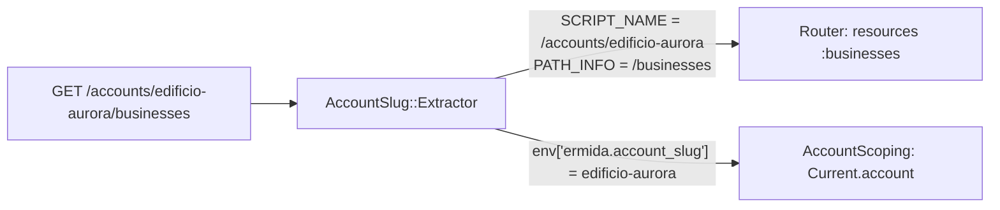

# The account slug as SCRIPT_NAME

## What it is

Rack splits a request path in two. `SCRIPT_NAME` is the prefix the app is mounted at, and `PATH_INFO` is the rest. The router only matches `PATH_INFO`, and URL helpers put `SCRIPT_NAME` back in front of every path they build.

A middleware that moves `/accounts/<slug>` from `PATH_INFO` into `SCRIPT_NAME` serves the whole app as if it were mounted once per account. `config/routes.rb` keeps a single set of unscoped routes. Inside an account, every helper produces paths under that account's prefix without being told.

## Why here, rather than a route scope

The obvious alternative is `scope "/accounts/:account_slug"` in the routes. Then every route exists twice, inside and outside the scope, or every URL helper needs an `account_slug:` argument (or `default_url_options`) to build a link. Basecamp's Fizzy uses the `SCRIPT_NAME` approach for the same reason. Ermida follows it, with the slug in place of Fizzy's numeric id.

## Example from this change

- `config/initializers/account_slug.rb` matches `%r{\A/accounts/([a-z0-9_-]+)(?=/|\z)}`. It skips `Account::RESERVED_SLUGS` (`new`, `edit`), so `/accounts/new` stays the create-account form. A match sets `request.script_name` and `request.engine_script_name`, and leaves the slug in the env.
- `AccountScoping#set_current_account` turns that slug into `Current.account`, and `Current#account=` also hands it to `acts_as_tenant`.
- A link that has to leave the account passes `script_name: nil`, as `session_path(script_name: nil)` does on the account page. Without it, sign-out would post to `/accounts/<slug>/session`.

## When not to use it

- When most pages live outside any tenant, the per-link `script_name: nil` becomes noise. A route scope is clearer there.
- When a tenant has its own host, read the host instead (subdomain tenancy).
- When routes under the prefix need dynamic segments of their own (`/accounts/:id/settings`). The middleware takes every `/accounts/<word>/` first, so such a route can never be reached.
