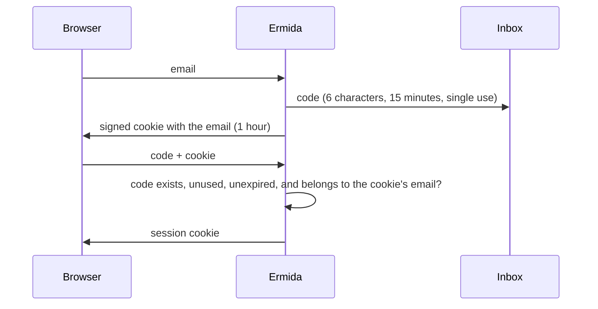

# Emailed sign-in codes bound to the requesting browser

## What it is

A person proves an email is theirs by typing a short code that was emailed to it. There is no password and no clickable link. Typing the email leaves a signed cookie in the browser that holds the email. A code only starts a session when it belongs to the email in that cookie. That is what makes "the code works only in the browser that asked for it" true: anyone else who has the code still lacks the cookie.

## Why here, instead of a clickable magic link

- A link opens wherever it is clicked: in a phone's mail app, or in an in-app browser. The session then lands in that browser, not in the one where the person started.
- A typed code works across devices. Someone can read it on a phone and type it on the computer.
- A link gives no defense against a code forwarded to someone else. The pending cookie does.

This is the design basecamp/fizzy uses. Ermida adds limits per email on top of Fizzy's limits per IP, so many IP addresses cannot pile up live codes for one person and guess them.

## Example in this codebase

`SessionsController#create` and `SignupsController#create` issue the code through `Identity#create_magic_link`, which caps it at 5 codes per 15 minutes. They send it through `MagicLinkDelivery` and set the cookie through `Authentication::ViaMagicLink`. `Sessions::MagicLinksController#create` consumes the code with `MagicLink.consume`, which deletes the row conditionally so only one request can use it. It then compares the code's email with the cookie's and starts the session.

## When not to use it

- **No reliable email delivery.** Every sign-in depends on mail arriving within minutes.
- **Machine clients that cannot read mail,** such as API tokens or CI. Give those their own credential.
- **When the requesting browser must not matter.** In flows that deliberately hand off between devices, such as a TV showing a pairing code, the browser binding gets in the way.
