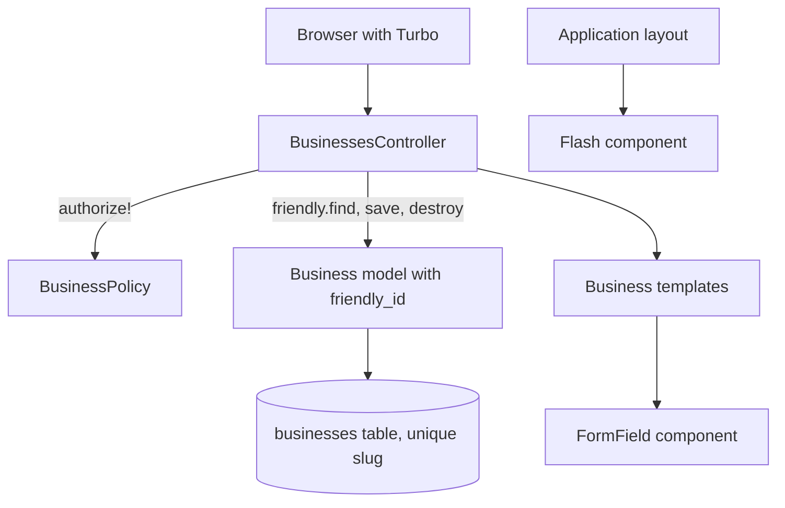

# Businesses CRUD - Plan

## Goal Capsule

- **Objective:** Anyone can list, view, create, edit and delete businesses in the browser, at readable URLs built from each business's name. The screens are the reference pattern for later CRUD work in Ermida, so their structure follows the repository's layered rules and their HTML follows daisyUI from the start.
- **Means:** a plain model with friendly_id slugs, an Action Policy policy that allows everyone, a CRUD-only controller, and two shared view components (KTD1, KTD2, KTD5, KTD6).
- **Authority:** the Product Contract's Requirements win on behavior; the Key Technical Decisions win on mechanism within them; `AGENTS.md`, `CODING_STANDARDS.md` and the `layered-rails` pack (`compound-packs/layered-rails/`) bind every unit.
- **Stop conditions:** stop and ask before changing any product behavior in the Requirements, and stop if friendly_id 5.7 cannot be installed on this app's Rails and Ruby versions, since friendly_id is the user's choice.
- **Execution profile:** one pull request from the `businesses` branch, built unit by unit in U-ID order.
- **Open blockers:** none.

---

## Product Contract

### Summary

Turbo-driven CRUD screens for `Business`, with `name` and `description`.
On creation, friendly_id turns the name into a unique, permanent slug that addresses the business in its URLs.
Every action goes through a policy that allows everyone today, and the HTML uses daisyUI 5 markup without installing its CSS yet.

### Problem Frame

The app has no screens yet; everything so far is base classes and wiring.
`Business` is the first resource people will manage from the browser, and whatever shape its controller, views, policy and tests take will be copied by the next resources.
Getting the layering and markup right here is cheaper than correcting several copies later.
Styling is not a concern of this work, but markup written without a target design system would have to be rewritten once one is installed.

### Key Decisions

- **Everyone may use every action, through a policy.** There is no login yet; routing every action through a policy keeps the future restriction to a policy change. Governs R15. (session-settled: user-directed — chosen over keeping the routes development-only and over building login first: the screens should be usable now, and only the policy should change later)
- **Deleting is permanent.** Governs R12. (session-settled: user-directed — chosen over soft delete with the discard gem: simplest behavior, accepting that deleted data cannot be recovered)
- **The name is required but not unique.** Governs R1, R2. (session-settled: user-directed — chosen over a unique name and over a length cap)
- **The slug is fixed at creation.** Old links keep working after a rename, at the cost of slugs that may drift from the current name. Governs R6. (session-settled: user-directed — chosen over regenerating on every rename, a hand-editable slug, and keeping ids in URLs)
- **Slug conflicts get a sequential suffix.** Creation never fails because of the slug. Governs R4, R5. (session-settled: user-directed — chosen over rejecting a name whose slug is taken)
- **friendly_id generates and resolves slugs.** Its defaults append a UUID on conflict, so the sequential-suffix and reserved-word rules depend on configuring it for sequential slugs and for treating reserved words as conflicts. Governs R3–R5, R8.
- **Markup follows daisyUI 5, but Tailwind and daisyUI are not installed here.** Pages render unstyled until a separate piece of work installs them. Governs R14. (session-settled: user-approved — the agent proposed leaving the CSS install out of this work and the user confirmed)

### Requirements

**Business records**

- R1. `name` is required; `description` is optional free text with no length limit.
- R2. Two businesses may share the same `name`.

**Slugs and URLs**

- R3. Creating a business generates a slug from its name: lowercase, accents transliterated, runs of other characters turned into single hyphens, and no hyphen at either end.
- R4. Slugs are unique; when a slug is taken, the business gets the number after the highest suffix in use for that slug (`-2`, `-3`, and so on).
- R5. `new` and `edit` count as taken slugs, so a name that would produce them gets a suffix per R4.
- R6. A slug never changes after creation, including when the name is edited, and it does not appear in the form.
- R7. A name that produces an empty slug, because it has no Latin letters or digits, is rejected with a validation error on `name`; names written only in other alphabets are rejected, and names made only of digits are accepted.
- R8. Business pages are addressed by slug rather than by id.

**Screens**

- R9. The index lists every business in alphabetical order by name, each linking to its page, with a link to create a new one.
- R10. The business page shows the name and description, with links to edit, delete and go back to the list.
- R11. The new and edit forms take `name` and `description`; an invalid submission shows the form again with its errors and the entered values.
- R12. Deleting asks for confirmation in the browser, then removes the business permanently.
- R13. After a create, update or delete, the user lands on the next page with a flash message confirming the action.

**Markup**

- R14. Every page's HTML uses daisyUI 5 component structure and class names (for example `btn`, `table`, `fieldset`, `input`, `alert`), checked against the daisyUI documentation available through the context7 MCP.

**Access and structure**

- R15. Every action is authorized through a `Business` policy, which allows all actions for everyone. (pack: layered-rails, authorization-lives-in-policies.md)
- R16. The controller exposes only the standard CRUD actions and handles HTTP only; the business rules in R1–R7 live in the model. (pack: layered-rails, controllers-expose-only-crud-actions.md) (pack: layered-rails, domain-logic-lives-in-models.md)
- R17. Reusable UI and view formatting live in view components with Lookbook previews, not in helpers or templates. (pack: layered-rails, view-logic-lives-in-presenters-and-components.md)
- R18. The slug and validation rules are tested at the model; controller and system tests cover HTTP behavior and the screens without re-testing those rules. (pack: layered-rails, tests-target-the-layer-that-owns-the-behavior.md)

Key Flows are omitted: these are standard CRUD screens, and R9–R13 with the examples below fix every path.

### Acceptance Examples

- AE1. Duplicate names
  - **Covers R3, R4.**
  - **Given** no businesses exist.
  - **When** "Padaria do João" is created three times.
  - **Then** the slugs are `padaria-do-joao`, `padaria-do-joao-2` and `padaria-do-joao-3`, and all three are saved.
- AE2. Reserved word
  - **Covers R5.**
  - **When** a business named "New" is created.
  - **Then** its slug is `new-2`, and `/businesses/new` still opens the creation form.
- AE3. Rename
  - **Covers R6.**
  - **Given** a business with slug `padaria-do-joao`.
  - **When** its name is changed to "Café Central".
  - **Then** its page is still at `/businesses/padaria-do-joao`.
- AE4. Name without letters or digits
  - **Covers R7.**
  - **When** a business named "!!!" is submitted.
  - **Then** nothing is saved and the form shows an error on `name`.
- AE5. Blank name
  - **Covers R1, R11.**
  - **When** the form is submitted with a blank name and a description.
  - **Then** nothing is saved and the form shows the error with the description still filled in.
- AE6. Slug freed by delete
  - **Covers R4, R12.**
  - **Given** businesses with slugs `padaria-do-joao` and `padaria-do-joao-2`.
  - **When** `padaria-do-joao` is deleted and a new "Padaria do João" is created.
  - **Then** the new business gets `padaria-do-joao`, so old links to the deleted business now open the new one.

### Scope Boundaries

- Login, users and any restriction on who may act.
- Installing Tailwind and daisyUI, themes and any visual styling.
- Pagination and search on the index; pagy and pg_search are in the Gemfile for when the list grows.
- Soft delete, undo and restoring deleted businesses.
- Editing a slug, and redirecting old slugs (friendly_id's history module).
- A JSON API, inline editing and modal dialogs.
- Pointing the root route `/` at the business list.
- Considered and not built: handling two simultaneous creates of the same name. The unique index on the slug rejects the second insert, which surfaces as an error page; in an app with no users yet this is rare and visible, and evidence of real concurrent use would change the call.

### Dependencies / Assumptions

- friendly_id is added to the Gemfile with a comment stating its purpose, as the `Gemfile` conventions in `AGENTS.md` require.
- The branch already has an uncommitted `Business` model, migration, factory and empty model test from `rails g model Business name:string description:text`, and that migration has run in development. The slug column is not part of it.

### Outstanding Questions

**Deferred to Implementation**

- Whether friendly_id's sequential slugs combined with reserved words treated as conflicts produce `new-2` for AE2. Its documentation only shows the UUID fallback for that option; the U1 model test settles it, and the Risks section says what to do if it does not.

### Sources / Research

- friendly_id: `UPGRADING.md` (UUID conflict suffix since 5.0; slugs not regenerated on save) and the `sequentially_slugged` and `reserved` API references, read through context7 (`/norman/friendly_id`). Latest release is 5.7.0.
- daisyUI 5 documentation through context7: `/saadeghi/daisyui` (fieldset, input, textarea, table, alert, btn, card).
- Generated files on this branch: `app/models/business.rb`, `db/migrate/20261104224020_create_businesses.rb`, `test/factories/businesses.rb`, `test/models/business_test.rb`.
- `package.json`: no Tailwind or daisyUI installed.

---

## Planning Contract

Product Contract preservation: the Outstanding Questions on migration shape, database uniqueness and lookups were answered here (KTD2, KTD4) and removed; the remaining one moved to Deferred to Implementation. Pointing `/` at the list and the concurrent-create case were added to Scope Boundaries as the user confirmed. R3 and R4 were clarified to state what friendly_id's chosen configuration does (no hyphen at either end; the suffix follows the highest one in use, so gaps left by deletions are not refilled); no acceptance example changed.

### Key Technical Decisions

- KTD1. **No form object, service, presenter or query object.** The specification test leaves nothing for them: the form writes one model with two fields and no screen-specific validation, the controller only reads the request and responds, nothing is formatted for display, and the index query is one ordering scope on the model. Governs R16. (pack: layered-rails, complex-input-goes-through-form-or-filter-objects.md) (pack: layered-rails, queries-scale-from-scopes-to-query-objects.md)
- KTD2. **friendly_id with `slugged`, `sequentially_slugged` and `reserved`, looked up through `Business.friendly`.** Reserved words are `new` and `edit` with `treat_reserved_as_conflict` on. The `history` and `finders` modules stay off: there is no slug history (scope), and an explicit `friendly` lookup keeps the plain `find` meaning ids. The friendly_id generator is not run, because its migration only creates the history table. Slug generation runs as friendly_id's `before_validation` callback, a transformer. Governs R3–R6, R8. (pack: layered-rails, model-callbacks-score-three-or-higher.md)
- KTD3. **R7 is a model validation on `name` that rejects a name whose normalized slug would be blank, on create and update alike.** friendly_id generates no slug at all for such a name, so without the validation the record would reach the database with a null slug. Applying it on update too keeps one rule for the field. Governs R7.
- KTD4. **Amend the generated, uncommitted migration instead of adding a second one.** `businesses` gets `name` as not-null, `slug` as not-null with a unique index, and `description` stays nullable text; the database matches the model, which the `database_consistency` gem checks. The migration was only ever run in this development database, so it is rolled back before the edit. Governs R1, R4. (session-settled: user-approved — chosen over a separate add-slug migration: the create migration has never left this machine)
- KTD5. **Authorization runs with no user.** `ApplicationPolicy` declares its `user` context as allowed to be nil, `ApplicationController` defines a private `current_user` that returns nil until login exists, and `BusinessPolicy` allows `index?`, `create?` and `manage?`, which the other CRUD rules fall back to. `BusinessesController` calls `authorize!` in every action and enforces it with `verify_authorized`. Enforcement stays out of `ApplicationController` because Mission Control (`/jobs`) inherits from it. Governs R15. (session-settled: user-approved — chosen over enforcing authorization app-wide: that would break `/jobs` in development)
- KTD6. **Two shared view components, in the view_component-contrib sidecar layout.** `Flash::Component` renders flash messages as daisyUI alerts in the layout. `FormField::Component` renders one labeled field (fieldset, legend, text input or textarea, and its error message) from a form builder and an attribute. Each has a `preview.rb` beside it for Lookbook. Everything specific to Business stays in its templates. Governs R11, R13, R17. (session-settled: user-approved — chosen over componentizing the table, page header and buttons: only these two repeat across future CRUD screens)
- KTD7. **Plain Turbo Drive with Rails 8 form conventions.** Invalid submissions render with status 422, deletion redirects with status 303, and the delete button carries a `turbo_confirm` message. No custom Stimulus controller is needed. Governs R11, R12.
- KTD8. **Interface text comes from `config/locales/en.yml`, in English, through lazy lookups.** Translating later means adding a locale file. Governs R9–R13. (session-settled: user-approved — chosen over hard-coded strings: no other locale is planned yet, and lazy lookups cost nothing now)

### High-Level Technical Design

A request crosses three layers; each box owns only its own job.



The controller is presentation, the policy is application, the model is domain; Archspec already enforces that the model and policy never call back up.

### Output Structure

```text
app/
  components/
    flash/            component.rb, component.html.erb, preview.rb
    form_field/       component.rb, component.html.erb, preview.rb
  controllers/        businesses_controller.rb
  models/             business.rb
  policies/           business_policy.rb
  views/businesses/   index, show, new, edit, _form (.html.erb)
test/
  components/         flash/component_test.rb, form_field/component_test.rb
  controllers/        businesses_controller_test.rb
  models/             business_test.rb
  policies/           business_policy_test.rb
  system/             businesses_test.rb
```

The per-unit Files lists are authoritative.

### Risks

- **friendly_id may not yield `new-2`.** If the combination in KTD2 produces a UUID suffix or a validation error for reserved words, keep R5 and make the model meet it, for example by excluding reserved words before friendly_id resolves the conflict; do not change the requirement.
- **friendly_id 5.7 on Rails 8.1 and Ruby 4.0 is unverified until `bundle install`.** An incompatibility hits a stop condition, since friendly_id was the user's choice.
- **Alphabetical order follows the database collation.** Case and accent ordering depend on it; tests use names that differ in their first letter and share case.

---

## Implementation Units

### U1. Business model with permanent slugs

- **Goal:** `Business` validates its name and gets a unique, permanent slug on creation.
- **Requirements:** R1–R8, R18; KTD2, KTD3, KTD4. Covers AE1–AE6 at the model.
- **Dependencies:** none.
- **Files:** `Gemfile`, `Gemfile.lock`, `db/migrate/20261104224020_create_businesses.rb`, `db/schema.rb`, `app/models/business.rb`, `test/factories/businesses.rb`, `test/models/business_test.rb`.
- **Approach:**
  1. Add `friendly_id` under "Active Record extensions" in the `Gemfile` with a purpose comment and the repo link, like its neighbors, and install it.
  2. Roll back the create migration, amend it per KTD4, and migrate again so `db/schema.rb` gains the slug column and index. Migrating also re-dumps `db/cable_schema.rb`, `db/cache_schema.rb` and `db/queue_schema.rb` with cosmetic changes; restore those three from `HEAD` so only `db/schema.rb` changes among the schema files.
  3. Write the model in the order `CODING_STANDARDS.md` and the layered-rails skill give: friendly_id declaration, validations, an alphabetical scope, then private methods ordered by first call.
  4. Give the factory a sequence-based name and a description.
- **Execution note:** write the slug tests first; AE2 is the one most likely to need a model-level adjustment (see Risks).
- **Patterns to follow:** model organization in the `layered-rails` skill's SKILL.md; method order and conditionals in `CODING_STANDARDS.md`.
- **Test scenarios:** (`test/models/business_test.rb` catches every slug and validation rule without HTTP; it misses routing and rendering.)
  - Covers AE1. Three businesses named "Padaria do João" get `padaria-do-joao`, `padaria-do-joao-2`, `padaria-do-joao-3`.
  - With `padaria-do-joao`, `-2` and `-3` in use and `-2` deleted, a new "Padaria do João" gets `padaria-do-joao-4`.
  - Covers AE2. A business named "New" gets `new-2`, and one named "Edit" gets `edit-2`.
  - Covers AE3. Changing the name of `padaria-do-joao` to "Café Central" and saving leaves the slug unchanged.
  - Covers AE4. "!!!" is invalid with an error on `name` and is not saved; updating an existing business's name to "!!!" is invalid too.
  - Covers AE5. A blank name is invalid with an error on `name`.
  - Covers AE6. After deleting `padaria-do-joao` while `padaria-do-joao-2` exists, a new "Padaria do João" gets `padaria-do-joao`.
  - "Café & Ção  Ltda." gets `cafe-cao-ltda`.
  - A nil description is valid.
  - `to_param` returns the slug.
  - The alphabetical scope returns "Alpha", "Bravo", "Charlie" in that order when created in another order.
- **Verification:** model tests pass and `db/schema.rb` shows `name` and `slug` not-null with a unique index on `slug`.

### U2. Authorization seam and Business policy

- **Goal:** Action Policy works with no user, and `BusinessPolicy` allows every CRUD rule.
- **Requirements:** R15; KTD5.
- **Dependencies:** none.
- **Files:** `app/policies/application_policy.rb`, `app/controllers/application_controller.rb`, `app/policies/business_policy.rb`, `test/policies/business_policy_test.rb`.
- **Approach:**
  1. Allow a nil `user` context in `ApplicationPolicy`, replacing its placeholder comment where it covers the same ground.
  2. Add the private `current_user` to `ApplicationController` with a one-line comment that login will replace it.
  3. Define `BusinessPolicy` with `index?`, `create?` and `manage?` returning true.
- **Patterns to follow:** "Minimal CRUD Rules" in the layered-rails `references/gems/action-policy.md`.
- **Test scenarios:** (`test/policies/business_policy_test.rb` catches the rule outcomes and the nil-user context; it misses whether the controller asks the policy, which U4 covers.)
  - With a nil user, `index?`, `show?`, `new?`, `create?`, `edit?`, `update?` and `destroy?` are all allowed for a business.
- **Verification:** policy tests pass, and `archspec check` stays green with the new policy in the application layer.

### U3. Flash and form field components

- **Goal:** the layout shows flash messages, and forms can render a labeled field with its errors, both in daisyUI markup.
- **Requirements:** R11, R13, R14, R17; KTD6.
- **Dependencies:** none.
- **Files:** `app/components/flash/component.rb`, `app/components/flash/component.html.erb`, `app/components/flash/preview.rb`, `app/components/form_field/component.rb`, `app/components/form_field/component.html.erb`, `app/components/form_field/preview.rb`, `app/views/layouts/application.html.erb`, `test/components/flash/component_test.rb`, `test/components/form_field/component_test.rb`.
- **Approach:**
  1. `Flash::Component` takes the flash and renders a `notice` as an `alert alert-success` with `role="status"` and an `alert` as an `alert alert-error` with `role="alert"`; it renders nothing when the flash is empty.
  2. `FormField::Component` takes a form builder, an attribute and the control kind (text input or textarea) and renders a `fieldset` containing the builder's `label` with the `fieldset-legend` class (a real `<label for>`, since a `<legend>` cannot point at a control and system tests fill fields by label), the control with `input` or `textarea`, plus `input-error` or `textarea-error`, `aria-invalid` and a `label text-error` message when the attribute has errors; the message gets an id derived from the form object and attribute, and the control's `aria-describedby` points at it so screen readers announce the reason.
  3. In the layout, render `Flash::Component` above a `<main>` that wraps `yield`.
  4. Previews show each state: notice, alert, field without errors, field with errors, textarea.
- **Patterns to follow:** `ApplicationViewComponent` and `ApplicationViewComponentPreview`; the sidecar layout configured in `config/initializers/view_component.rb` and `config/application.rb`; class names checked against context7 `/saadeghi/daisyui`.
- **Test scenarios:** (component tests catch the markup and the error states in isolation; they miss whether pages use the components, which U4 and U5 cover.)
  - A notice renders one `alert alert-success` with the message and `role="status"`.
  - An alert renders one `alert alert-error` with the message and `role="alert"`.
  - An empty flash renders nothing.
  - A text field for a valid attribute renders a `fieldset`, a `label` with class `fieldset-legend` whose `for` matches the input's id, and an `input` without `input-error`.
  - A text field for an attribute with errors adds `input-error`, `aria-invalid="true"` and the error message, and the input's `aria-describedby` matches the message's id.
  - A textarea field renders a `textarea` and keeps the value the builder holds.
- **Verification:** component tests pass and each preview renders in `/lookbook`.

### U4. Businesses controller, routes, views and copy

- **Goal:** the seven CRUD screens and actions work at slug URLs, each authorized through the policy.
- **Requirements:** R6, R8–R16; KTD1, KTD5, KTD7, KTD8. Covers AE2, AE3 and AE5 over HTTP.
- **Dependencies:** U1, U2, U3.
- **Files:** `config/routes.rb`, `app/controllers/businesses_controller.rb`, `app/views/businesses/index.html.erb`, `app/views/businesses/show.html.erb`, `app/views/businesses/new.html.erb`, `app/views/businesses/edit.html.erb`, `app/views/businesses/_form.html.erb`, `config/locales/en.yml`, `test/controllers/businesses_controller_test.rb`.
- **Approach:**
  1. Add `resources :businesses`.
  2. The controller loads records with `Business.friendly.find`, permits only `name` and `description`, calls `authorize!` in every action, runs `verify_authorized`, and responds per KTD7 with flash text from lazy lookups.
  3. The index renders the alphabetical scope in a daisyUI `table` inside an `overflow-x-auto` wrapper, with a `btn` link to the new form.
  4. The show page renders the name and description (line breaks kept) in a `card`, with `btn` links to edit and back and a `button_to` delete styled `btn btn-error` with the confirmation.
  5. The form uses `form_with` and `FormField::Component` for both fields, with a `btn btn-primary` submit; new and edit render it with their own titles.
  6. Add the page titles, button labels, confirmation and flash texts to `config/locales/en.yml`.
- **Patterns to follow:** "Controller Integration" in the layered-rails `references/gems/action-policy.md`; `controllers-expose-only-crud-actions.md` in the pack.
- **Test scenarios:** (`test/controllers/businesses_controller_test.rb` catches status codes, redirects, flash, routing and authorization; it does not re-test slug rules and misses browser behavior such as the confirmation dialog.)
  - The index lists "Alpha" before "Bravo" and links each to its slug path.
  - Covers AE2. With a business whose slug is `new-2`, `GET /businesses/new` renders the creation form.
  - Showing a business by slug renders its name and description; an unknown slug responds 404.
  - A valid create redirects to the new business's slug path and sets the created notice.
  - Covers AE5. A create with a blank name responds 422, saves nothing and re-renders the form with the description filled in.
  - A create that sends `slug` gets a slug generated from the name, not the one sent.
  - Covers AE3. Renaming redirects to the unchanged slug path with the updated notice.
  - An update with a blank name responds 422.
  - Destroy responds 303, redirects to the index with the deleted notice, and removes the record.
  - Every action is authorized through `BusinessPolicy`, checked with Action Policy's test helpers.
- **Verification:** controller tests pass, Prosopite reports no N+1 on the index, and `archspec check` and RuboCop pass.

### U5. Browser flow

- **Goal:** the whole CRUD works in a real browser, including the delete confirmation.
- **Requirements:** R9–R13; KTD7.
- **Dependencies:** U4.
- **Files:** `test/system/businesses_test.rb`.
- **Approach:** one system test class on `ApplicationSystemTestCase`, run through `dip rails test:system` so it reaches the `chrome` service.
- **Test scenarios:** (the system test catches Turbo, form submission and the confirmation dialog end to end; it misses rule edge cases, which stay in U1.)
  - Creating "Padaria do João" from the index lands on `/businesses/padaria-do-joao` with the created notice and the entered description.
  - Submitting the form with a blank name shows the error and keeps the description.
  - Editing the name lands on the same URL with the new name and the updated notice.
  - Deleting and accepting the confirmation returns to the index with the deleted notice, and the business is gone.
  - Deleting and dismissing the confirmation leaves the business in place.
- **Verification:** `dip rails test:system` passes.

---

## Verification Contract

| Gate | Command | Proves |
|---|---|---|
| Unit, policy, component and controller tests | `dip rails test` | U1–U4 scenarios |
| System tests | `dip rails test:system` | U5 browser flow |
| Style | `dip rubocop` | Standard compliance |
| Layer boundaries | `dip archspec check` | no reverse dependencies from the model or policy |
| Full local CI | `dip ci` | everything above plus brakeman, audits and seeds |

Also review the diff with the layered-rails `workflows/review.md`, as the pack requires for Rails diffs. (pack: layered-rails, rails-diffs-get-the-layered-rails-review.md)

---

## Definition of Done

- Every requirement R1–R18 is met and every acceptance example AE1–AE6 has a passing test that covers it.
- `dip ci` passes, system tests included.
- The layered-rails review of the diff finds no violation left unaddressed.
- Every component preview renders in `/lookbook`.
- The Gemfile entry carries its purpose comment; no friendly_id generator migration or initializer was added.
- No experimental or abandoned code remains in the diff, and the diff touches no schema dump other than `db/schema.rb`.