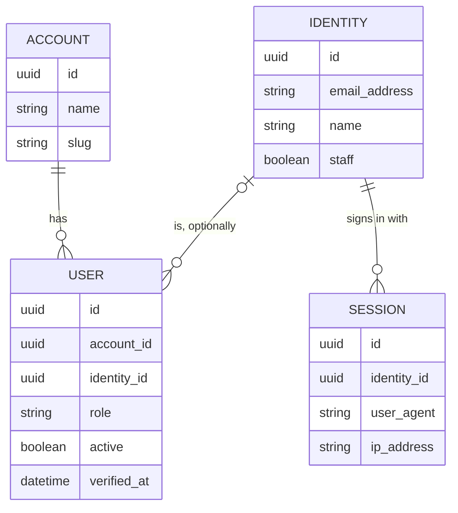
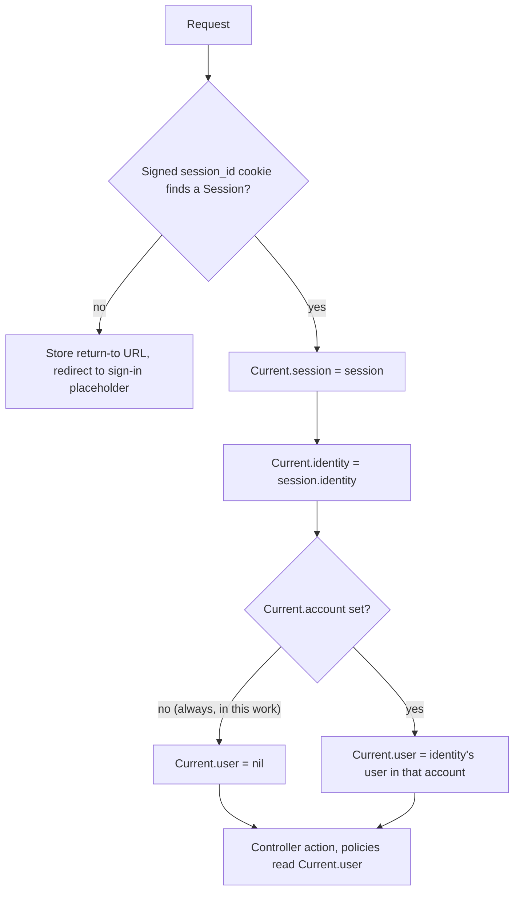

# Accounts, Identities and Users - Plan

## Goal Capsule

- **Objective:** Ermida knows who a person is and which condominium they belong to, and every page sits behind a session, so the next pieces of work (sign-in by emailed code, screens inside a condominium) only add behavior on top of an existing structure. Nobody can sign in yet.
- **Means:** the Rails 8.1 `authentication` generator as the starting point, reshaped to Fizzy's Account / Identity / User split, with everything about passwords removed (KTD1).
- **Authority:** the Product Contract's Requirements win on behavior; the Key Technical Decisions win on mechanism within them; `AGENTS.md`, `CODING_STANDARDS.md`, `Archspec.rb` and the `layered-rails` pack (`compound-packs/layered-rails/`) bind every unit.
- **Stop conditions:** stop and ask before changing product behavior in the Requirements, and stop if `dip archspec check` rejects `Current` living in `app/models/` (KTD4), since moving it changes where every later piece of work reads the session.
- **Execution profile:** one pull request from the `users` branch, built unit by unit in U-ID order; each unit leaves `dip rails test` green.
- **Who finishes:** the implementer runs the Verification Contract, including the manual development checks, and opens the PR.
- **Open blockers:** none.

---

## Product Contract

### Summary

Three models: `Account` (a condominium), `Identity` (a person, by email) and `User` (a person's place in one condominium, with a role).
Sessions belong to the identity, `Current` carries session, identity, user and account, and the `Authentication` concern requires a session on every page.
There is no password and no way to sign in yet: the sign-in page is a placeholder, and tests sign in by creating a session directly.

### Problem Frame

The app so far has one resource, `Business`, open to everyone, with a `current_user` that always returns nil and a policy layer waiting for a user.
Ermida serves condominiums, where residents and service providers act inside one condominium, and one person can belong to more than one.
Login by emailed code, invitations and condominium-scoped screens all depend on knowing who the person is and where they act.
Fizzy (basecamp/fizzy) solved the same shape with three models after starting with one: it first kept email and password on `User`, then had to split out `Identity` a year later so a person could move between accounts with one login.
Starting with the split avoids that migration.

### Key Decisions

- **Fizzy's three-model split, with the name on the identity.** A person has one `Identity` and one `User` per condominium; the name belongs to the person, not to each membership. Governs R4–R13. (session-settled: user-directed — chosen over Campfire's single `User` holding login and role: a person may belong to several condominiums with different roles)
- **No password at all.** The generator gives the session machinery; its password login, password reset and mailer are removed, so nobody can sign in until the emailed-code work lands. Governs R17, R18. (session-settled: user-directed — chosen over keeping a password on the identity for now and over skipping the generator: passwords would be built only to be thrown away)
- **Authentication is on and blocks every page now.** Governs R16, R17. (session-settled: user-directed — chosen over keeping the concern but allowing unauthenticated access on businesses, and over not including the concern yet: the app should behave as it will once sign-in exists)
- **A user's identity is optional, as in Fizzy.** A system user has none, and a user who leaves a condominium loses it, so returning creates a new user. Governs R9, R12. (session-settled: user-directed — chosen over a required identity with reactivation of the same user on return)
- **An account is a condominium; `Business` is untouched.** Governs R1–R3. (session-settled: user-directed — chosen over giving `Business` an account in this work)
- **The account is not resolved from the URL yet.** `Current.account` exists but nothing sets it, so `Current.user` is always nil in this work. Governs R15. (session-settled: user-approved — the agent proposed deferring the slug-prefix middleware until there are condominium-scoped screens, and the user agreed)
- **Development tools stay outside authentication.** Governs R20. (session-settled: user-approved — the agent proposed it after showing that `/jobs` would otherwise be unreachable, and the user agreed)
- **Deactivation is an `active` flag, as in Fizzy, not the `discard` gem.** Governs R11, R12. (session-settled: user-approved — the agent proposed following Fizzy and the user confirmed the scoping synthesis)
- **UUID primary keys for accounts, identities, users and sessions.** `Business` keeps its integer id. Governs R2, R7, R10, R14. (session-settled: user-approved — the user asked for a UUID on accounts and Fizzy's shape for the rest; the agent proposed UUIDs on all four and the user confirmed)
- **The name stays only on the identity, even though deactivated and system users then have none.** Screens that show an author will label an identity-less user generically ("former resident", "system") when they exist. Governs R5, R8, R12. (session-settled: user-directed — chosen over keeping a copy of the name on `users`, as Fizzy does, and over keeping the identity on deactivation)
- **An identity that still has users cannot be deleted.** No flow deletes identities in this work, so refusing is the safe default until account deletion is designed. Governs R9. (session-settled: user-approved — the agent proposed it over Fizzy's callback that deactivates the users first, which the `layered-rails` callback scoring rates as an operation to extract, and the user agreed)

### Model relationships

### Requirements

**Accounts (condominiums)**

- R1. An account has a required `name` with the same length cap as a business name.
- R2. An account's id is a UUID.
- R3. An account's `slug` follows the `Business` slug rules: generated once from the name with friendly_id, unique, sequential suffix on conflict, never changed after creation.

**Identities (people)**

- R4. An identity has a required `email_address`, unique across the whole app, stored stripped and lowercased, and rejected when it is not an email.
- R5. An identity has a required `name`.
- R6. An identity has a `staff` flag, false by default, with no behavior attached yet.
- R7. An identity's id is a UUID.

**Users (a person in a condominium)**

- R8. A user belongs to one account, which is required, and has no name of its own.
- R9. A user optionally belongs to one identity, and an identity that still has users cannot be deleted.
- R10. A user's id is a UUID.
- R11. A user has a `role`, one of `member` (resident), `provider` (service provider), `admin`, `owner` or `system`, defaulting to `member`; an `active` flag, true by default; and a nullable `verified_at`, with no behavior attached yet.
- R12. Deactivating a user sets `active` to false and clears its identity.
- R13. An account has at most one user per identity, enforced in the database.

**Sessions and the current request**

- R14. A session has a UUID id, belongs to an identity, and records the user agent and IP address of the request that created it.
- R15. `Current` holds the session, identity, user and account: setting the session sets the identity, and the identity together with the account finds the user. Only controllers read it. (pack: layered-rails, domain-logic-lives-in-models.md)
- R16. Every page of the app requires a session; a request without one is redirected to the sign-in page.
- R17. The sign-in page is a placeholder with no form that says signing in is not available yet; signing out ends the session.
- R18. Nothing stores or checks a password: no password column, no password reset screens or mailer, and `bcrypt` leaves the `Gemfile`.
- R19. Policies receive the user from the controller's `current_user`, which returns `Current.user` and is nil in this work; `BusinessPolicy` keeps allowing everyone. (pack: layered-rails, authorization-lives-in-policies.md)
- R20. In development, Mission Control (`/jobs`), PgHero, Letter Opener and Lookbook open without a session.
- R21. Tests can sign in as an identity by creating a session directly, and the business controller and system tests sign in that way. (pack: layered-rails, tests-target-the-layer-that-owns-the-behavior.md)

### Acceptance Examples

- AE1. **Covers R16, R17.** **Given** no session, **when** someone opens `/businesses`, **then** they are redirected to the sign-in page, which shows that signing in is not available yet.
- AE2. **Covers R19, R21.** **Given** a test signed in as an identity, **when** it opens `/businesses`, **then** the list renders as it does today.
- AE3. **Covers R4.** **Given** an identity with `ana@example.com`, **when** another identity is saved with ` Ana@Example.com `, **then** it is stored as `ana@example.com` and rejected as taken.
- AE4. **Covers R9, R13.** **Given** Ana's identity has a user in condominium A, **when** a user for her is added to condominium B, **then** it is saved; **when** a second user for her is added to condominium A, **then** it is rejected.
- AE5. **Covers R12, R13.** **Given** Ana's user in condominium A is deactivated, **then** it is inactive with no identity, and a new user for Ana's identity in condominium A can be created.
- AE6. **Covers R9, R11.** **Given** condominium A, **when** a user with role `system` and no identity is created, **then** it is saved.
- AE7. **Covers R20.** **Given** development and no session, **when** someone opens `/jobs`, **then** Mission Control loads.
- AE8. **Covers R9.** **Given** Ana's identity has a user in condominium A, **when** the identity is deleted, **then** the deletion is refused and both records remain.

### Scope Boundaries

- Signing in by any means: emailed code (Fizzy's `MagicLink`), passkeys, API tokens.
- Sign-up, invitations and join codes, creating a condominium with its owner, and creating a system user per condominium.
- Resolving the condominium from the URL (slug prefix and middleware), and therefore any non-nil `Current.user`. That work also decides which account slugs must be reserved, since a condominium named after a top-level route would collide with it.
- Linking `Business` to `Account`.
- Any rule that depends on role, `staff` or `verified_at`.
- Screens to manage accounts, identities or users.
- Deleting an identity, or a person deleting their own data; per R9 the deletion is refused while users exist.

#### Considered and not built

- Storing the return-to URL only for GET requests, and skipping Turbo prefetches. Nothing reads the stored URL until sign-in exists; the emailed-code work decides it with the code that consumes it.
- Clearing a signed cookie whose session no longer exists. The request is treated as signed out and redirected, which is correct; a stale cookie only costs one lookup per request.
- Authenticating Action Cable connections. No channel or `turbo_stream_from` exists, so the generated connection is deleted in U1; the first channel decides how it identifies the identity.
- An automated test for AE7. Development tools are mounted only in development, so the test environment has no `/jobs`; it is a manual check in the Verification Contract.

#### Deferred to Follow-Up Work

- Running `database_consistency` in CI. It already fails on `Business` (`slug` unique index and NOT NULL without matching validators), so turning it on is its own change.
- Extracting the shared friendly_id slug setup of `Business` and `Account` into one concern, once a third model needs it.

### Sources

- Fizzy (github.com/basecamp/fizzy): `app/models/identity.rb`, `app/models/user.rb`, `app/models/account.rb`, `app/models/current.rb`, `app/controllers/concerns/authentication.rb`, and the `accounts` / `identities` / `users` / `sessions` tables in `db/schema.rb`. Its history shows the generator adopted in `e3983d5bbe` and `Identity` split out in `3399e45130`.
- Campfire (github.com/basecamp/once-campfire), the single-tenant alternative considered and rejected.
- `.compound-engineering/artifacts/plans/2026-11-04-1951-feat-businesses-crud-plan.md`: KTD5 (`current_user` returns nil; Mission Control inherits from `ApplicationController`) and the slug rules this plan reuses for accounts.
- `app/models/business.rb`, `app/controllers/application_controller.rb`, `app/policies/application_policy.rb`, `Archspec.rb` (domain may not reference `Current`; application and domain may not call `session` or `cookies`).

---

## Planning Contract

**Product Contract preservation:** changed: Key Decisions and Scope Boundaries gained the two decisions settled during planning (name only on the identity; an identity with users cannot be deleted), R9 gained its deletion clause, AE8 was added, and R19 was reworded so policies get the user through the controller, matching R15's rule that only controllers read `Current`. Outstanding Questions were resolved into KTD2, KTD8 and U1–U3. No other requirement changed.

### Key Technical Decisions

- KTD1. **Run the generator, then reshape its output.** `dip rails generate authentication` produces the session machinery; U1 deletes every password piece and U2–U3 rewrite the rest for the identity. Writing the files by hand from the templates would churn less, but the generated shape is what later Rails upgrades and the next tasks build on. (session-settled: user-directed — chosen over hand-writing from the templates: the user asked to generate and evolve from the generated code)
- KTD2. **UUIDv7 primary keys, declared per table.** Each new table uses `id: :uuid` with PostgreSQL 18's built-in `uuidv7()` as the default, and its foreign keys are typed `uuid`. Version 7 is time-ordered, so `first`/`last` and index locality behave like integer ids; no extension is needed. The generators config is not changed, because `Business` and future tables decide per table. Governs R2, R7, R10, R14.
- KTD3. **`database_validations` backs uniqueness and required parents.** `validates_db_uniqueness_of` covers the identity email, the account slug, and the user's identity scoped to its account; `db_belongs_to` covers the user's account and the session's identity. This is the gem's first use in the repo; `Business` is left as it is. The unique `(account_id, identity_id)` index keeps PostgreSQL's default NULLs-distinct behavior, so identity-less users never collide. Governs R3, R4, R8, R13, R14. (session-settled: user-approved — the agent proposed it after the user asked that the repo's gems be used, and the user confirmed the synthesis)
- KTD4. **`Current` is a holder; finding the user is a domain rule on `Identity`.** `Current` lives in `app/models/current.rb` with `session`, `identity`, `user` and `account`. Setting the session sets the identity; setting the identity or the account asks the identity for its active user in that account, through an `Identity` method that returns nil without an account. Filtering on `active` keeps a former resident out even if some later writer sets `active` false without going through `deactivate`. Only the `Authentication` concern sets `Current`, and no model references it. Governs R15. (session-settled: user-approved — the `layered-rails` review moved the lookup out of `Current`, where Fizzy keeps it, and the user agreed) (pack: layered-rails, domain-logic-lives-in-models.md)
- KTD5. **Deactivation is a single event method.** `User#deactivate` is the only way `active` changes, it clears the identity in the same save and there is no reactivation, so a boolean carries the whole lifecycle without a state machine. `verified_at` records when a fact happened and has no transitions yet. This is a deliberate exception to the explicit-state-machine rule (pack: layered-rails, lifecycle-state-is-an-explicit-state-machine.md): with one one-way transition there are no moves for a state machine to validate. Revisit it when a second transition, such as reactivation, appears. Governs R11, R12.
- KTD6. **Identity deletion is refused by the association, not a callback.** `has_many :users` restricts destruction and `has_many :sessions` destroys them. Governs R9. (pack: layered-rails, model-callbacks-score-three-or-higher.md)
- KTD7. **`Account` copies the `Business` slug setup.** Same friendly_id modules, reserved words, 100-character name cap and `name_must_produce_a_slug` check; extraction waits for a third use (Scope Boundaries). Governs R1, R3. (session-settled: user-approved — the agent proposed copying over extracting a shared concern now, and the user confirmed the synthesis)
- KTD8. **Mission Control gets `ActionController::Base` as its base controller in development.** One setting next to the existing `http_basic_auth_enabled` line in `config/environments/development.rb`; the other development engines already inherit from `ActionController::Base`. Governs R20. (session-settled: user-approved — the agent proposed keeping development tools outside authentication and the user agreed)
- KTD9. **The generator's `Authentication` concern stays close to the template.** Session lookup by the signed `session_id` cookie, `start_new_session_for(identity)` kept for the emailed-code work, `terminate_session` for sign-out, and the return-to URL still stored on redirect. `after_authentication_url` is removed: nothing calls it and it falls back to a `root_url` this app does not have. Governs R16, R17.
- KTD10. **Tests sign in by writing the session cookie.** Integration tests use the generator's `sign_in_as`, adapted to take an identity. System tests create a session, sign the cookie value with the same test cookie jar, visit the sign-in page so the browser has the app's host, then set the cookie through Cuprite, URL-escaping the value because signed cookies can contain `+`. Governs R21. (pack: layered-rails, tests-target-the-layer-that-owns-the-behavior.md)

### High-Level Technical Design

How a request reaches a user in this work. The account step is where the condominium URL work will plug in; until then it never runs, so `Current.user` stays nil (R15, R19).

### Assumptions

- `dip archspec check` accepts `class Current` defined in `app/models/`, since defining a constant is not referencing it; the Stop conditions cover the case where it does not.
- `uuidv7()` dumps into `db/schema.rb` as a function default that `db:schema:load` and the test database reproduce on PostgreSQL 18, which CI already runs.

---

## Implementation Units

### U1. Generate the authentication scaffold and strip passwords

- **Goal:** the generator's files exist, nothing about passwords does, and the app behaves as before.
- **Requirements:** R18; KTD1.
- **Dependencies:** none.
- **Files:**
  - Delete after generating: `app/controllers/passwords_controller.rb`, `app/mailers/passwords_mailer.rb`, `app/views/passwords_mailer/`, `app/views/passwords/`, `test/controllers/passwords_controller_test.rb`, `test/mailers/previews/passwords_mailer_preview.rb`, `test/fixtures/users.yml`, `test/models/user_test.rb`, `test/controllers/sessions_controller_test.rb`, `app/channels/application_cable/connection.rb`, and the generated `db/migrate/*_create_users.rb` and `*_create_sessions.rb`.
  - Modify: `Gemfile`, `Gemfile.lock`, `config/routes.rb`, `app/controllers/application_controller.rb`, `app/models/user.rb`, `app/controllers/sessions_controller.rb`, `app/views/sessions/new.html.erb`.
- **Approach:**
  1. Run the generator through `dip`.
  2. Delete the files listed above; U2 and U3 write their own migrations and tests.
  3. Remove `bcrypt` and its comment from the `Gemfile` and update the lock; the "Authentication and authorization" section keeps only Action Policy.
  4. Remove `has_secure_password` from the generated `User`, and the `create` action, rate limit and `allow_unauthenticated_access` line from `SessionsController`, so every class loads without bcrypt or the concern. Replace the generated `sessions/new` password form and its "Forgot password?" link with an empty placeholder that U3 fills in.
  5. Change the generated routes to `resource :session, only: %i[new destroy]` and drop the passwords route.
  6. Take out the injected `include Authentication` for now; U3 adds it back with the tests that need it.
  7. Run `dip rubocop -a` so the generated files follow Standard.
- **Patterns to follow:** `AGENTS.md` (commands through `dip`; Gemfile comments).
- **Test expectation:** none -- scaffolding with no behavior yet; the existing suite must stay green.
- **Verification:** `dip rails test` passes, the app also eager-loads as CI does (`CI=1 dip rails test`), `bcrypt` is absent from `Gemfile.lock`, and no file mentions passwords.

### U2. Accounts, identities, users and sessions

- **Goal:** the four tables and models exist with the rules R1–R14 describe.
- **Requirements:** R1–R14, AE3–AE6, AE8; KTD2, KTD3, KTD5, KTD6, KTD7.
- **Dependencies:** U1.
- **Files:**
  - Create: four migrations under `db/migrate/` (accounts, identities, users, sessions), `app/models/account.rb`, `app/models/identity.rb`, `test/factories/accounts.rb`, `test/factories/identities.rb`, `test/factories/users.rb`, `test/factories/sessions.rb`, `test/models/account_test.rb`, `test/models/identity_test.rb`, `test/models/user_test.rb`, `test/models/session_test.rb`.
  - Modify: `app/models/user.rb`, `app/models/session.rb`, `db/schema.rb`.
- **Approach:**
  1. Write the migrations per KTD2: `null: false` on required columns, `role` a string defaulting to `member`, `active` defaulting to true, `staff` defaulting to false, unique indexes on `identities.email_address`, `accounts.slug` and `users (account_id, identity_id)`, and typed `uuid` references with foreign keys.
  2. Migrate in development, then restore the Solid schema dumps per the solution doc below.
  3. `Account` per KTD7, plus `has_many :users`.
  4. `Identity`: `normalizes` the email (strip, downcase), presence and email-format validation, required name with the same 100-character cap, associations per KTD6, and the user-in-account lookup per KTD4.
  5. `User`: `db_belongs_to :account`, optional identity, the role enum over `member provider admin owner system` validated so an unknown value is an error rather than an exception, and `deactivate` per KTD5.
  6. `Session`: belongs to its identity per KTD3.
  7. Factories: identity with a sequenced email and a name, user with account and identity plus `system` and `deactivated` traits, where `deactivated` goes through `deactivate`, and session with an identity.
- **Patterns to follow:** `app/models/business.rb`, `db/migrate/20261104224020_create_businesses.rb`, `test/models/business_test.rb`, `test/factories/businesses.rb`; declaration order in `CODING_STANDARDS.md`.
- **Test scenarios:**
  - Account: a new account gets a slug from its name, and the same name twice gets `-2`.
  - Account: a name producing `new` or `edit` gets a suffix.
  - Account: renaming keeps the original slug.
  - Account: a blank name, a 101-character name, and a name with no Latin letters or digits are each rejected.
  - Account: the id is a UUID.
  - Covers AE3. An identity saved with ` Ana@Example.com ` stores `ana@example.com`, and a second identity with `ana@example.com` is rejected as taken.
  - Identity: an address without `@` is rejected, and a blank name is rejected.
  - Identity: `staff` defaults to false.
  - Identity: the user lookup returns the identity's user in a given account, nil for an account where it has none, and nil without an account.
  - Identity: the user lookup skips a user that is inactive but still has the identity.
  - Covers AE8. Deleting an identity that has a user raises and leaves both rows.
  - Identity: deleting an identity without users deletes its sessions.
  - User: a new user is an active `member` with no `verified_at`.
  - User: each of the five roles saves, and an unknown role adds an error.
  - User: a user without an account is rejected.
  - Covers AE6. A `system` user without an identity saves.
  - Covers AE4. The same identity gets users in two accounts; a second user for it in the same account is rejected as taken.
  - Covers AE5. Deactivating sets `active` false and clears the identity, and a new user for that identity in the same account then saves.
  - User: two deactivated users and a system user coexist in one account.
  - Session: a session without an identity is rejected.
- **Verification:** model tests pass, `db/schema.rb` shows the four tables with `uuidv7()` defaults, and the Solid schema files are unchanged.

### U3. Require a session on every page

- **Goal:** every app page needs a session, the sign-in placeholder and sign-out work, `/jobs` stays open in development, and the business tests sign in.
- **Requirements:** R15–R17, R19–R21, AE1, AE2, AE7; KTD4, KTD8–KTD10.
- **Dependencies:** U2.
- **Files:**
  - Create: `test/models/current_test.rb`, `test/controllers/sessions_controller_test.rb`, a system-test sign-in module under `test/` included by `test/application_system_test_case.rb`.
  - Modify: `app/models/current.rb`, `app/controllers/concerns/authentication.rb`, `app/controllers/sessions_controller.rb`, `app/views/sessions/new.html.erb`, `app/controllers/application_controller.rb`, `app/policies/application_policy.rb`, `app/policies/business_policy.rb`, `config/locales/en.yml`, `config/environments/development.rb`, `test/test_helpers/session_test_helper.rb`, `test/application_system_test_case.rb`, `test/controllers/businesses_controller_test.rb`, `test/system/businesses_test.rb`.
- **Approach:**
  1. `Current` per KTD4.
  2. The concern per KTD9, starting sessions from an identity.
  3. `ApplicationController` includes the concern and returns `Current.user` from `current_user`; refresh the "no login yet" comments here and in both policies without changing their rules.
  4. `SessionsController`: `new` open to anyone and `destroy` signing out to the sign-in page with `:see_other`. The `new` view is a daisyUI card with a title and one line saying signing in is not available yet, with copy in `en.yml`.
  5. The Mission Control setting per KTD8.
  6. Test helpers per KTD10; the business controller and system tests sign in during setup.
- **Patterns to follow:** generator templates for the concern, controller and helper; `app/views/businesses/index.html.erb` and `Flash::Component` for the page; `test/controllers/businesses_controller_test.rb` style.
- **Test scenarios:**
  - Current: setting the session sets the identity from it.
  - Current: with no account, the user is nil; with an account where the identity has a user, the user is that user.
  - Covers AE1. Without a session, `GET /businesses` redirects to the sign-in page, which renders the "not available yet" copy.
  - Sessions: `GET /session/new` succeeds without a session.
  - Sessions: `DELETE /session` while signed in destroys the session, deletes the cookie, and redirects to the sign-in page with 303.
  - Sessions: `DELETE /session` without a session redirects to the sign-in page.
  - Authentication: a cookie pointing at a deleted session redirects like no session.
  - Covers AE2. Signed in through the helper, every existing business controller test passes unchanged, including its `assert_authorized_to` checks.
  - Business system tests pass after signing in through the system helper.
- **Verification:** `dip rails test` and `dip rails test:system` pass; in `dip rails s`, `/businesses` lands on the placeholder and `/jobs` loads (AE7).

### U4. Document sign-in for tests and the authentication building block

- **Goal:** the next person knows sessions exist and how tests sign in.
- **Requirements:** R21.
- **Dependencies:** U3.
- **Files:** `AGENTS.md`.
- **Approach:** add the integration and system sign-in helpers to the test-helpers bullet, and an "Authentication" entry to the building blocks: sessions belong to identities, `Current` is set only by the `Authentication` concern, and nobody can sign in yet.
- **Test expectation:** none -- documentation only.
- **Verification:** the two `AGENTS.md` entries match the helpers and files U3 created.

---

## Verification Contract

| Check | Command or step | Proves |
|---|---|---|
| Unit and integration tests | `dip rails test` | R1–R19, R21, AE1–AE6, AE8 |
| System tests | `dip rails test:system` | R16, R21 in a browser |
| Style | `dip rubocop` | Standard on generated and new files |
| Layers | `dip archspec check` | No model references `Current`; KTD4's assumption |
| Full local CI | `dip ci` | Audits, brakeman, seeds and both suites together |
| Manual, development | `dip rails s`, then open `/businesses` and `/jobs` | AE1 in the browser, AE7 |

## Definition of Done

- Every unit's Verification holds and every check above passes.
- No file in the diff mentions passwords, `bcrypt` or `has_secure_password`.
- `db/cable_schema.rb`, `db/cache_schema.rb` and `db/queue_schema.rb` are unchanged.
- `CONCEPTS.md` keeps its Account, Identity, User and Role entries in line with the code.
- Generated files that ended up unused and any abandoned attempt are removed from the diff.

## Appendix

### Sources for implementation

- Rails 8.1.4.1 generator templates: `railties/lib/rails/generators/rails/authentication/`, plus the `erb/authentication` (views) and `test_unit/authentication` (tests, fixture, session test helper) hooks.
- `.compound-engineering/artifacts/solutions/developer-experience/migrate-rewrites-solid-schema-dumps.md`: restore the Solid schema dumps after migrating, and roll back with `dip rails db:rollback:primary`.
- Mission Control Jobs 1.3.1 `lib/mission_control/jobs.rb` (`base_controller_class` defaults to `"::ApplicationController"`); PgHero 4.1.0, Letter Opener Web 3.0.0 and Lookbook 2.3.15 base controllers inherit from `ActionController::Base`.
- `test/application_system_test_case.rb` (Cuprite, `CHROME_URL`, `Capybara.app_host`) for the system sign-in helper.
