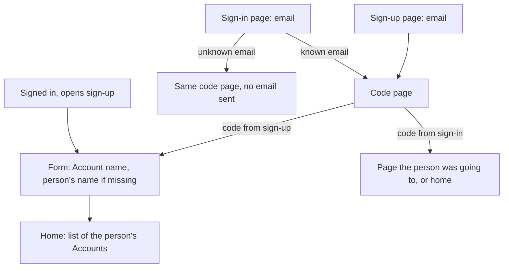
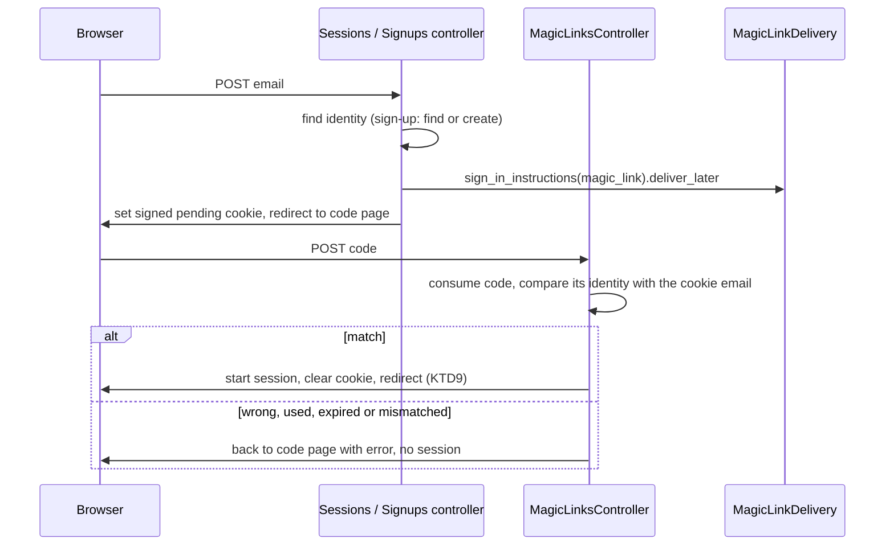
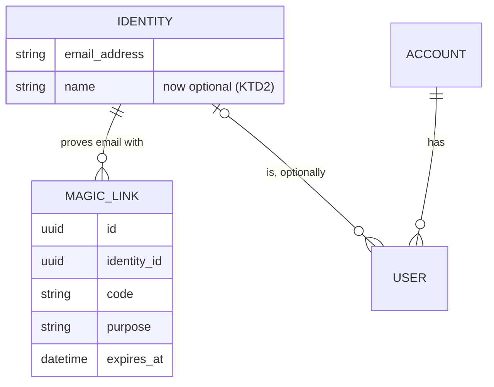

# Account Sign-up - Plan

## Goal Capsule

- **Objective:** A síndico creates their condominium's Account alone, after proving their email with a code sent to it, and anyone who has an Account signs back in the same way. There are no passwords.
- **Means:** Fizzy's sign-in and sign-up by emailed code (basecamp/fizzy), adapted to Ermida's Account / Identity / User models.
- **Authority:**
  - The Requirements below win on behavior.
  - The Key Technical Decisions win on mechanism within them.
  - `AGENTS.md`, `CODING_STANDARDS.md`, `Archspec.rb` and the `layered-rails` pack (`compound-packs/layered-rails/`) bind every unit.
  - Joining an existing Account (Fizzy's join link) and resolving the Account from the URL are not active scope.
- **Stop conditions:**
  - Stop and ask before changing behavior in the Requirements.
  - Stop if making the person's name optional (KTD2) breaks a caller that needs a name, since that would change a decision from the accounts, identities and users work.
- **Execution profile:** one pull request from the `account-signup` branch, built in dependency order: U1, U2, U4, U3, U5, U6. Each unit leaves `dip rails test` green.
- **Who finishes:** the implementer runs the Verification Contract, including the manual development check, and opens the PR.
- **Open blockers:** none.

---

## Product Contract

### Summary

A public sign-up page takes an email, sends a 6-character code and, once the code is typed, asks for the Account's name (and the person's name if Ermida does not have it yet). The Account is created with that person as its owner.
The sign-in page uses the same code to let people back in.
After sign-up the person lands on a home page that lists their Accounts. After sign-in they return to the page they were trying to reach, or to that home page.

### Problem Frame

Since the accounts, identities and users work (`.compound-engineering/artifacts/plans/2026-11-05-1509-feat-accounts-identities-users-plan.md`), every page needs a session, but nothing creates one.
The sign-in page is a placeholder, and Accounts and Identities exist only when a developer creates them in the console or in tests.
The síndico is the person who brings a condominium into Ermida, so they need a way to do that alone.
Residents and service providers join later, through a separate piece of work.
With no password, the emailed code is the only way to prove that an email belongs to the person typing it.
Without that proof, anyone could register someone else's email.
Because an email belongs to only one Identity, the real owner would then be locked out.

### Actors

- A1. Síndico: creates an Account for the condominium they run, and may run more than one.
- A2. Returning person: already has an Identity and signs back in.
- A3. Unknown visitor: types an email Ermida does not know on the sign-in page.

### Key Decisions

- **Sign-up and sign-in ship together, sharing one code flow.** Governs R1–R10. (session-settled: user-approved — chosen over sign-up alone and over sign-in alone first: without the code anyone could claim someone else's email, and without sign-in a síndico could not return once the session ended)
- **The síndico creates the Account; residents only ever join by invitation.** Invitation is a later piece of work. Governs R11, R13. (session-settled: user-directed — the user stated it when asked who creates Accounts, over Fizzy's rule that any unknown email starts a new account)
- **Sign-up lives on its own open page; the sign-in page never creates anything.** Governs R9, R11. (session-settled: user-approved — chosen over a sign-up page gated by an invite code or manual approval, and over Accounts created only from the console; the accepted risk is that anyone, a resident included, can create an Account)
- **Email first, then the code, then the form, so only a verified email can create an Account.** Governs R11, R12. (session-settled: user-directed — chosen over one form with email, names and Account name before the code, to avoid unchecked sign-ups, as Fizzy does)
- **Code only, as in Fizzy, with no clickable link in the email.** Governs R1, R2. (session-settled: user-approved — the difference from a "magic link" was shown in the scoping synthesis and the user confirmed "igual ao Fizzy")
- **The person lands on a home page listing their Accounts, unless sign-in returns them to the page they were going to.** Governs R8, R13, R16. (session-settled: user-approved — chosen over putting the Account in the URL now, which would set `Current.account`, and over a blank landing page; the URL comes in its own later work)
- **One person may create several Accounts, and a signed-in person skips straight to the form.** Governs R14. (session-settled: user-approved — chosen over one Account per person, which would force a síndico of two buildings to use two emails)
- **The product calls it an "account".** The pages say "account", never "condomínio". (session-settled: user-directed — the user rejected a "Cadastrar condomínio" page: "tamo tratando como account")
- **The form asks for the Account's name, unlike Fizzy, which generates it from the person's name.** Governs R12. (session-settled: user-approved — shown in the scoping synthesis and confirmed; a condominium named after its síndico would be wrong)
- **Joining an Account through Fizzy's join link is out of this work.** It gets its own brainstorm, following Fizzy. (session-settled: user-directed — chosen over bringing it into this work: "Essa tarefa agora é só pro cadastro de account")

### Requirements

**Code by email**

- R1. A person proves an email by typing the 6-character code sent to it. The email carries the code and no link.
- R2. A code works for 15 minutes, once, and only in the browser that asked for it. Asking again does not cancel earlier codes that have not expired.
- R3. Code entry accepts lowercase, spaces and look-alike characters (O read as 0; I and L read as 1).
- R4. A wrong, used or expired code returns to the code page with an error and starts no session.
- R5. Expired codes are removed from storage periodically.
- R6. In development, the code page also shows the code. It never shows it in any other environment.
- R7. Attempts are limited per IP: 10 email submissions per 3 minutes on each of the sign-in and sign-up pages, and 10 code entries per 15 minutes.

**Sign-in**

- R8. A known email typed on the sign-in page gets a code. Once the code is accepted, the person goes to the page they were trying to reach, if it is inside Ermida, or otherwise to the home page.
- R9. An unknown email typed on the sign-in page gets the same "check your email" page as a known one. No email is sent and nothing is created.
- R10. A signed-in person opening the sign-in or code pages goes to the home page.

**Sign-up**

- R11. A public sign-up page, separate from sign-in and linked from it, asks only for an email and sends a code. This works the same whether the email is new or already known.
- R12. After the code, a form asks for the Account's name, and for the person's name only when Ermida has none for them.
- R13. Submitting the form creates the Account with the person as its owner user and with the Account's system user, then lands the person on the home page.
- R14. A signed-in person opening the sign-up page goes straight to the form, so one person can create several Accounts.
- R15. A person who accepts the code but leaves before submitting the form stays signed in and has no Account.

**Home**

- R16. The home page lists the Accounts where the person has an active user. When there are none, it shows the way to create one.

### Key Flows

- F1. Sign-up
  - **Trigger:** A1 opens the sign-up page.
  - **Steps:** types email; receives the code; types it; fills the form; the Account is created.
  - **Outcome:** A1 is signed in and the home page lists the new Account.
  - **Covered by:** R1–R4, R11–R13
- F2. Sign-in
  - **Trigger:** A2 opens a page while signed out and is sent to sign-in, or opens sign-in directly.
  - **Steps:** types email; receives the code; types it.
  - **Outcome:** A2 is signed in, back on the page they wanted or on the home page.
  - **Covered by:** R1–R4, R8

### Acceptance Examples

- AE1. **Covers R11, R12, R13.** Given an email Ermida has never seen, when the person signs up, types the code and fills both names, then an Account exists with that person as owner plus a system user, and the home page lists it.
- AE2. **Covers R12.** Given an Identity that already has a name, when that person signs up for a new Account, then the form asks only for the Account's name.
- AE3. **Covers R14, R16.** Given a signed-in owner of one Account, when they open the sign-up page, then they see the form with no email or code step, and after submitting, the home page lists both Accounts.
- AE4. **Covers R9.** Given an email Ermida does not know, when it is typed on the sign-in page, then the same "check your email" page appears, no email is sent and no Identity is created.
- AE5. **Covers R8.** Given a signed-out person who opens the businesses page, when they sign in with the code, then they land on the businesses page.
- AE6. **Covers R2.** Given a code requested in browser A, when it is typed in browser B, then it is rejected and no session starts.
- AE7. **Covers R2, R4.** Given a code requested 16 minutes ago, when it is typed, then the code page shows an error and no session starts.
- AE8. **Covers R15, R16.** Given a person who accepted a sign-up code and closed the tab before the form, when they come back, then they are signed in and the home page offers to create an Account.

### Scope Boundaries

- Joining an existing Account through Fizzy's join link, and any invitation of residents or service providers: next brainstorm.
- The Account in the URL, `Current.account` and `Current.user`: they stay unset in this work.
- Passkeys, a clickable link in the email, and the JSON / native-app flow Fizzy also offers.
- Approval, caps or invite codes on sign-up.
- Changing a user's role, avatars, and Fizzy's account import.

### Dependencies / Assumptions

- Production email delivery is not configured: the SMTP settings in `config/environments/production.rb` are commented out and the mailer host is `example.com`. The flow works in development through `/letter_opener`. Going live needs delivery set up.
- There are no real users yet, so the sign-up and sign-in pages can change freely.

### Sources / Research

- Fizzy (basecamp/fizzy), the reference implementation:
  - `app/models/magic_link.rb` and `app/models/magic_link/code.rb`
  - `app/controllers/sessions_controller.rb` and `app/controllers/sessions/magic_links_controller.rb`
  - `app/controllers/concerns/authentication/via_magic_link.rb`, which holds the cookie that binds a code to the browser
  - `app/controllers/signups_controller.rb`, `app/controllers/signups/completions_controller.rb` and `app/models/signup.rb`
  - `app/mailers/magic_link_mailer.rb`
  - `Account.create_with_owner` in `app/models/account.rb`
- Ermida today:
  - `app/controllers/concerns/authentication.rb`: `start_new_session_for` is ready but unused, and `request_authentication` stores the return path for GET requests.
  - `app/views/sessions/new.html.erb`: the placeholder sign-in page.
  - `config/routes.rb`: there is no root route.
  - `config/recurring.yml`: holds the recurring jobs.

---

## Planning Contract

Product Contract preservation: Product Contract unchanged. Its two questions deferred to planning are answered by KTD2 (where the name lives) and KTD9 (the session on sign-in), and they are removed from it.

### Key Technical Decisions

- KTD1. **Codes are a `magic_links` table, as in Fizzy.** Each row has the code (unique), expiry, the identity it belongs to and a purpose (`sign_in` or `sign_up`, a string enum like `User#role`), with a UUID key like the other auth tables. A `MagicLink::Code` value object owns code generation and input cleanup. It defines its own Crockford base32 alphabet (digits plus uppercase letters except I, L, O and U) and generates with `SecureRandom.alphanumeric(6, chars: ALPHABET)`, because Fizzy's `SecureRandom.base32` comes from Rails main and does not exist on Rails 8.1.4. Cleanup keeps only that alphabet, which is what makes R3's look-alike substitutions safe. The code is stored as typed, there is no attempt counter, and requesting again leaves earlier codes alone, which is Fizzy's trade-off: 15 minutes, one use, and the rate limits bound guessing. Implements R1–R5.
- KTD2. **`identities.name` becomes optional, and the form asks for it when it is missing.** As in Fizzy, the sign-up email step creates the Identity before any name exists. The alternative, creating the Identity only after the code, would need codes that point at a bare email instead of a person. `Identity` keeps the length limit but drops the presence check, and the account form owns the "name required when missing" rule. Implements R11, R12.
- KTD3. **A signed cookie binds the code to the browser that asked for it.** Typing an email sets an HttpOnly, SameSite=Lax cookie holding that email, signed with `Rails.application.message_verifier(:pending_authentication)`. The cookie lives one hour, longer than the code, so an expired code still reaches the code page and fails there as R4 requires (Fizzy expires the cookie with the code, which would send an expired code back to the email page instead). The code page refuses to work without the cookie, and an accepted code must belong to the identity whose email the cookie holds (`ActiveSupport::SecurityUtils.secure_compare`). Otherwise the cookie is cleared and no session starts. This is Fizzy's `Authentication::ViaMagicLink`. Implements R2.
- KTD4. **An unknown email on the sign-in page gets the same cookie and the same redirect, with no record and no email.** A malformed email is treated the same way. Any code typed on that page then fails as a wrong code. Implements R9.
- KTD5. **The code email goes out through `MagicLinkDelivery`, not from the model.** `Identity#create_magic_link(purpose:)` only creates the row. The controller calls `MagicLinkDelivery.sign_in_instructions(magic_link).deliver_later`, which fans out to `MagicLinkMailer`. This differs from Fizzy, where `Identity#send_magic_link` calls the mailer. (pack: layered-rails, notifications-go-through-deliveries.md)
- KTD6. **Every screen is a CRUD resource:**
  - `resource :session` (`new`, `create`, `destroy`), with `resource :magic_link` (`show`, `create`) nested under the `sessions` module;
  - `resource :signup` (`new`, `create`);
  - `resources :accounts` (`index`, `new`, `create`), with `root` pointing at `accounts#index`.

  The home page is the accounts index. The account form is `accounts#new`, used both after a sign-up code and by a signed-in person. (pack: layered-rails, controllers-expose-only-crud-actions.md)
- KTD7. **`Account.create_with_owner(name:, owner:)` creates the Account, its system user and the owner user in one transaction.** The owner gets `verified_at`, as in Fizzy. The domain rule lives on the model. (pack: layered-rails, domain-logic-lives-in-models.md)
- KTD8. **`AccountForm` in `app/forms/` takes the account form's input.** It validates the Account name, and the person's name only when the identity has none. In one transaction it saves the name on the identity and calls `Account.create_with_owner`, then rescues `ActiveRecord::RecordInvalid` and copies the Account's validation errors so the form shows them. This is the first form object in the repo, and Archspec already places `app/forms/` in presentation. (pack: layered-rails, complex-input-goes-through-form-or-filter-objects.md)
- KTD9. **Redirect rules:**
  - The `Authentication` concern gains `require_unauthenticated_access`, which allows unauthenticated access and sends a signed-in person to `root_path` (R10).
  - `SignupsController` sends a signed-in person to `new_account_path` instead (R14).
  - After a code is accepted, `sign_up` goes to `new_account_path`, and `sign_in` goes to `session.delete(:return_to_after_authenticating) || root_path` (R8).
  - The stored return path is always `request.fullpath`, so it can only point inside Ermida.
  - As in Fizzy, signing in does not reset the Rails session. The session cookie is a fresh signed id, so fixation does not apply.
- KTD10. **Rate limits use Rails' `rate_limit`, keyed by IP, with a `with:` handler that redirects back to the same page with an alert, as Fizzy does, instead of Rails' bare 429.** Its store is the Solid Cache in development and production, with the R7 numbers. The test environment's `:null_store` never trips a limit, so the tests that prove the limits need a real store. The mechanism is deferred to implementation.
- KTD11. **In development the code is also passed to the code page through the flash, as in Fizzy.** An `after_action` raises if that flash key is ever set outside development. Implements R6.
- KTD12. **Stale codes are deleted by `MagicLink.cleanup`, run from `config/recurring.yml` under `production` every 4 hours, as in Fizzy.** Implements R5.
- KTD13. **`AccountsController` uses `verify_authorized` and an `AccountPolicy` whose `index?` and `create?` allow anyone signed in, the way `BusinessPolicy` does while `current_user` is nil.** `ApplicationPolicy` already declares `authorize :user, allow_nil: true` for this period. The listing stays scoped through `Current.identity.accounts`, and the policy is where the rule tightens once the Account is in the URL. (pack: layered-rails, authorization-lives-in-policies.md)

### High-Level Technical Design

The code flow, shared by sign-in and sign-up:

The models this work touches:

### Assumptions

- The UI copy is English like the rest of the app (`config/locales/en.yml`), and it says "account" (Key Decisions).
- Mail keeps `ApplicationMailer`'s default sender. Production delivery is a dependency, not part of this work.

---

## Implementation Units

### U1. Codes and the optional name

- **Goal:** Ermida can issue, check, consume and clean up sign-in codes for an Identity, and an Identity can exist without a name.
- **Requirements:** R1, R2, R3, R5, R11 (KTD1, KTD2, KTD12)
- **Dependencies:** none
- **Files:**
  - `db/migrate/<timestamp>_create_magic_links.rb`
  - `db/migrate/<timestamp>_allow_identities_without_name.rb`
  - `db/schema.rb`
  - `app/models/magic_link.rb`
  - `app/models/magic_link/code.rb`
  - `app/models/identity.rb`
  - `config/recurring.yml`
  - `test/factories/magic_links.rb`
  - `test/models/magic_link_test.rb`
  - `test/models/magic_link/code_test.rb`
  - `test/models/identity_test.rb`
- **Approach:**
  1. Create the table with a unique index on `code`, an index on `expires_at` and a foreign key to `identities`. Dropping the NOT NULL on `identities.name` is safe for strong_migrations.
  2. In `MagicLink`:
     - `belongs_to :identity`;
     - the purpose enum;
     - `active` and `stale` scopes;
     - code and expiry set before create, retrying until the code is unused;
     - `MagicLink.consume(code)`, which cleans the input, finds an active link and destroys it;
     - `MagicLink.cleanup`.
  3. On `Identity`: `has_many :magic_links, dependent: :destroy`, `create_magic_link(purpose:)`, and drop the name presence check.
  4. Add `cleanup_magic_links` under `production` in `config/recurring.yml`.
- **Patterns to follow:**
  - Fizzy's `app/models/magic_link.rb` and `app/models/magic_link/code.rb`.
  - In Ermida, `User`'s string enum and `db_belongs_to`.
  - The earlier migrations' UUIDv7 default.
- **Test scenarios:**
  - A new link gets a 6-character code whose characters all belong to the Crockford alphabet (never I, L, O or U), and it expires 15 minutes from now.
  - `consume` with the exact code returns the link and deletes it, so a second `consume` returns nil.
  - `consume` accepts lowercase, spaces, dashes, and O, I and L typed for 0, 1 and 1.
  - `consume` ignores an expired link and leaves it in place.
  - `consume` returns nil for nil, blank and unknown codes.
  - `cleanup` deletes expired links and keeps active ones.
  - Creating a second link for the same identity leaves the first one usable.
  - An Identity saves without a name, and a name over 100 characters is still rejected.
- **Verification:** model tests pass, and `db/schema.rb` shows the new table and the nullable name.

### U2. The code email

- **Goal:** a person receives an email whose subject and body carry the code and no link.
- **Requirements:** R1 (KTD5)
- **Dependencies:** U1
- **Files:**
  - `app/deliveries/magic_link_delivery.rb`
  - `app/mailers/magic_link_mailer.rb`
  - `app/views/magic_link_mailer/sign_in_instructions.html.erb`
  - `app/views/magic_link_mailer/sign_in_instructions.text.erb`
  - `test/mailers/previews/magic_link_mailer_preview.rb`
  - `test/mailers/magic_link_mailer_test.rb`
  - `test/deliveries/magic_link_delivery_test.rb`
- **Approach:**
  - The mailer action is `sign_in_instructions(magic_link)`.
  - The subject is "Your Ermida code is <code>".
  - The body copy depends on the purpose ("sign in" versus "finish creating your account") and says the code works for 15 minutes.
  - The delivery declares the mailer as its only channel.
- **Patterns to follow:**
  - `ApplicationDelivery` and the Active Delivery convention in `AGENTS.md`.
  - Fizzy's `app/mailers/magic_link_mailer.rb` and its views.
- **Test scenarios:**
  - The sign-in email goes to the identity's address, and both its subject and body contain the code.
  - The sign-up email uses the sign-up wording.
  - The email body contains no URL.
  - `MagicLinkDelivery.sign_in_instructions(link).deliver_later` enqueues the mailer delivery.
- **Verification:** mailer tests pass, and the preview renders in development.

### U3. Sign-in by code

- **Goal:** a known person signs in with the code and lands where they were going. An unknown email sees the same page and gets nothing.
- **Requirements:** R2, R4, R6, R7, R8, R9, R10; F2; AE4, AE5, AE6, AE7 (KTD3, KTD4, KTD9, KTD10, KTD11)
- **Dependencies:** U1, U2, U4 (the home page at `root`)
- **Files:**
  - `app/controllers/concerns/authentication.rb`
  - `app/controllers/concerns/authentication/via_magic_link.rb`
  - `app/controllers/sessions_controller.rb`
  - `app/controllers/sessions/magic_links_controller.rb`
  - `app/views/sessions/new.html.erb`
  - `app/views/sessions/magic_links/show.html.erb`
  - `config/routes.rb`
  - `config/locales/en.yml`
  - `test/controllers/sessions_controller_test.rb`
  - `test/controllers/sessions/magic_links_controller_test.rb`
- **Approach:**
  1. `Authentication`:
     - add `require_unauthenticated_access`;
     - add `after_authentication_url`, which uses the stored return path or `root_path`;
     - include `ViaMagicLink`, which sets and reads the pending cookie and redirects to the code page (real or fake);
     - add the development-only flash guard.
  2. `SessionsController`:
     - `new` is the email form, linked to sign-up;
     - `create` looks up the identity, creates a `sign_in` link and calls the delivery, or follows KTD4;
     - `destroy` is unchanged.
  3. `Sessions::MagicLinksController`:
     - `show` requires the pending cookie, else redirects to `new_session_path` asking for the email;
     - `create` consumes the code and checks the cookie;
     - on success it starts the session with `start_new_session_for`, clears the cookie and follows KTD9;
     - on failure it redirects back to `show` with an alert.
  4. Forms submit with Turbo and redirect with `status: :see_other`.
  5. The code field uses `autocomplete="one-time-code"`.
- **Patterns to follow:**
  - Fizzy's `sessions_controller.rb`, `sessions/magic_links_controller.rb` and `concerns/authentication/via_magic_link.rb`.
  - In Ermida, `BusinessesController` for flash and status codes, and the `FormField` and `Flash` components.
- **Test scenarios:**
  - `POST /session` with a known email creates one `sign_in` link, enqueues the email and redirects to the code page.
  - Covers AE4. `POST /session` with an unknown email redirects to the same code page, creates no Identity and no link, and enqueues no email.
  - A malformed email behaves like an unknown one.
  - `GET` on the code page without the pending cookie redirects to the sign-in page.
  - Covers AE5. A signed-out `GET /businesses`, then the email and the right code, ends on `/businesses` with a session cookie.
  - Without a stored path, the right code ends on the home page.
  - A wrong code returns to the code page with an alert, and no session cookie is set.
  - Covers AE7. An expired code (`travel` 16 minutes) returns to the code page with an alert, starts no session, and stays in the table.
  - Covers AE6. A code that belongs to another identity than the cookie's email is rejected, the cookie is cleared and no session starts.
  - A code is accepted once, and the second attempt fails.
  - A signed-in person on `GET /session/new` or the code page is redirected to the home page.
  - In development the code reaches the code page, and in the test environment the flash never holds it.
  - The 11th `POST /session` within 3 minutes from one IP redirects back to the sign-in page with an alert and sends no email, and the 11th code attempt within 15 minutes redirects back to the code page with an alert (KTD10).
  - `DELETE /session` still signs out.
- **Verification:**
  - Controller tests pass.
  - In development, signing in through `/letter_opener` works end to end.

### U4. Account creation and the home page

- **Goal:** a signed-in person creates an Account as its owner and sees their Accounts on the home page.
- **Requirements:** R12, R13, R14, R15, R16; AE2, AE3, AE8 (KTD6, KTD7, KTD8, KTD13)
- **Dependencies:** U1
- **Files:**
  - `app/policies/account_policy.rb`
  - `test/policies/account_policy_test.rb`
  - `app/models/account.rb`
  - `app/models/identity.rb`
  - `app/forms/account_form.rb`
  - `app/controllers/accounts_controller.rb`
  - `app/views/accounts/index.html.erb`
  - `app/views/accounts/new.html.erb`
  - `config/routes.rb`
  - `config/locales/en.yml`
  - `test/models/account_test.rb`
  - `test/models/identity_test.rb`
  - `test/forms/account_form_test.rb`
  - `test/controllers/accounts_controller_test.rb`
- **Approach:**
  - `Account.create_with_owner` follows KTD7.
  - `Identity` gains `accounts`: those reached through its active users, ordered by name.
  - `AccountForm` follows KTD8.
  - `AccountsController` calls `verify_authorized` and authorizes each action against `AccountPolicy` (KTD13):
    - `index` lists `Current.identity.accounts` and shows a "create an account" link when the list is empty;
    - `new` and `create` drive the form, re-rendering with `:unprocessable_content` on errors.
  - The home page also has a sign-out button. The `destroy` action exists, but no page reaches it today.
  - `root` points at `accounts#index`.
- **Patterns to follow:**
  - `BusinessesController`, `BusinessPolicy` and its test, and the businesses views.
  - The `layered-rails` form-object reference that the pack cites.
- **Test scenarios:**
  - `AccountPolicy` allows `index?` and `create?` with no user.
  - `Account.create_with_owner` creates one Account with exactly one system user (no identity) and one owner user (that identity, `verified_at` set).
  - `Account.create_with_owner` with a blank name raises `ActiveRecord::RecordInvalid` and creates nothing.
  - `Identity#accounts` excludes Accounts where the person's user is deactivated.
  - Covers AE2. For an identity that has a name, the form requires only the Account name and leaves the identity's name unchanged.
  - For an identity without a name, the form rejects a blank person name, and on success it saves the name.
  - A name that produces no slug shows the Account's error on the form, and nothing is created.
  - Covers AE3. A signed-in owner of one Account creates a second one, and the home page lists both.
  - Covers AE8. A signed-in identity with no users sees the empty home page with the create link.
  - A signed-out visit to `/` redirects to sign-in, which is the existing `Authentication` behavior.
- **Verification:**
  - Model, form and controller tests pass.
  - `dip archspec check` accepts `app/forms/`.

### U5. Sign-up by code

- **Goal:** anyone can start an Account from the public sign-up page, proving their email with the code first.
- **Requirements:** R11, R12, R13, R14; F1; AE1 (KTD2, KTD9, KTD10)
- **Dependencies:** U3, U4
- **Files:**
  - `app/controllers/signups_controller.rb`
  - `app/controllers/sessions/magic_links_controller.rb`
  - `app/views/signups/new.html.erb`
  - `app/views/sessions/new.html.erb`
  - `config/routes.rb`
  - `config/locales/en.yml`
  - `test/controllers/signups_controller_test.rb`
  - `test/controllers/sessions/magic_links_controller_test.rb`
- **Approach:**
  - `SignupsController` allows unauthenticated access, and a signed-in person is redirected to `new_account_path`.
  - `create`:
    - validates the email format, re-rendering with an error when it is invalid;
    - finds or creates the Identity, guarding the unique-email race;
    - creates a `sign_up` link, calls the delivery and redirects to the code page with the pending cookie.
  - `Sessions::MagicLinksController` sends `sign_up` links to `new_account_path`.
  - The sign-in page links to sign-up.
- **Patterns to follow:** Fizzy's `signups_controller.rb` and `signups/completions_controller.rb`, with Fizzy's completion step replaced by `accounts#new` (KTD6).
- **Test scenarios:**
  - `POST /signup` with a new email creates an Identity without a name and one `sign_up` link, enqueues the email and redirects to the code page.
  - `POST /signup` with a known email creates no new Identity and one `sign_up` link.
  - An invalid email re-renders the form with an error and creates nothing.
  - The right `sign_up` code ends on `new_account_path` with a session.
  - Covers AE1. A new email, then the code, then both names, gives an Account with that person as owner plus a system user, and the home page lists it.
  - A signed-in person on `GET /signup/new` is redirected to `new_account_path`.
  - The 11th `POST /signup` within 3 minutes from one IP redirects back to the sign-up page with an alert and sends no email.
- **Verification:** controller tests pass.

### U6. End-to-end check and docs

- **Goal:** one browser test proves the whole sign-up, and the project docs stop saying that nobody can sign in.
- **Requirements:** F1, F2; AE1
- **Dependencies:** U5
- **Files:**
  - `test/system/signups_test.rb`
  - `AGENTS.md`
  - `CONCEPTS.md`
  - `test/test_helpers/system_session_test_helper.rb` (only if the redirect for signed-in visitors breaks it)
- **Approach:**
  - The system test types an email on the sign-up page.
  - It reads the code from the database (`MagicLink.last.code`), since emails are enqueued and not delivered in tests.
  - It types the code, fills the form and checks the home page.
  - In `AGENTS.md`, update the Authentication bullet: there is now sign-in and sign-up by emailed code, the home page lists accounts, and `Current.account` is still unset.
  - In `CONCEPTS.md`, check that the Sign-up and Sign-in code entries still match what was built, and correct them if not.
- **Patterns to follow:** `test/system/businesses_test.rb`.
- **Test scenarios:**
  - Covers AE1. A full sign-up in the browser ends on the home page showing the new Account's name.
  - A sign-out button on the home page returns to sign-in.
- **Verification:** `dip rails test:system` passes.

---

## Scope Boundaries (planning)

The Product Contract's Scope Boundaries govern. These concerns were considered and not built:

- **Hashed codes and per-code attempt counters.** Fizzy stores codes as typed and relies on expiry, single use and per-IP limits (KTD1). Revisit if codes ever live longer or guessing shows up in logs.
- **Cancelling earlier codes when a new one is requested.** Fizzy keeps them valid until they expire. Revisit if people report confusion over which code works.
- **Secure cookies and `force_ssl`.** They belong with turning on production, alongside email delivery (Dependencies / Assumptions).

### Deferred to Follow-Up Work

- Production SMTP and mailer host settings.
- Joining an Account through a join link (next brainstorm).

---

## Verification Contract

| Check | Command | Proves |
|---|---|---|
| Unit and controller tests | `dip rails test` | U1–U5 scenarios |
| System test | `dip rails test:system` | U6, AE1 end to end |
| Lint | `dip rubocop` | Standard |
| Layers | `dip archspec check` | `app/forms/` and the delivery sit in their layers, and no model reads `Current` |
| Full local CI | `dip ci` | brakeman, audits, seeds and everything above |
| Manual, development | `dip rails s`, then sign up and sign in through `/letter_opener` | R6 and the email copy, on the real app |

---

## Definition of Done

- Every unit's test scenarios exist and pass, and every Verification Contract row is green.
- The manual development check signed up a new Account and signed back in with a second code.
- `AGENTS.md` and `CONCEPTS.md` describe sign-in and sign-up as they now work.
- No code from abandoned attempts remains in the diff.

---

## Deferred / Open Questions

These are review items left for the author. They do not block implementation.

### From 2026-11-05 review

- **Someone with many IP addresses can guess a chosen person's code** — Requirements, attempt limits per IP, and KTD1 (P1, security-lens, confidence 75)

  An attacker can take over a chosen person's Identity by spreading requests across many IPs. The limits are per IP, nothing caps codes per email, and earlier codes stay valid. So an attacker can keep thousands of codes active for one email while guessing from many addresses. With about 1,000 proxy IPs, a code is likely guessed within an hour, and anyone can flood any inbox with code emails. Fizzy has the same gap, so closing it departs from "igual ao Fizzy".
  Change: Add a cap per email address, shared by the sign-in and sign-up pages (for example 5 codes per email per 15 minutes). Past the cap, the page shows the same "check your email" response and creates no code. Add tests showing that a sixth request for one email from different IPs creates no code and sends no email.

- **A síndico who already has an Account sees no way to create another** — Home page, U4 (P2, design-lens, confidence 75)

  One person may create several Accounts, but the home page shows the create link only when the list is empty. A síndico with one Account can reach the form only by typing the sign-up URL.
  Change: Always show a "New account" link on the home page, and keep the larger prompt for the empty list.
