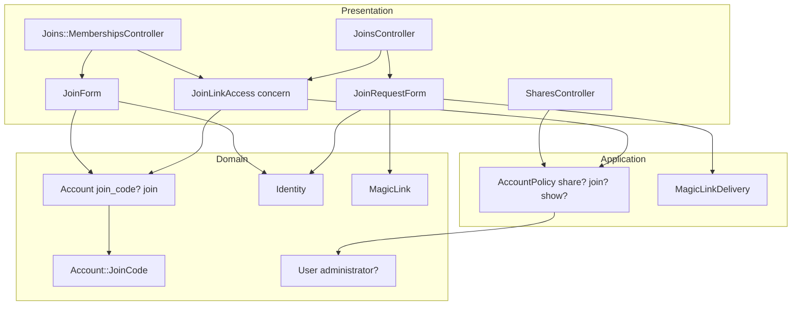
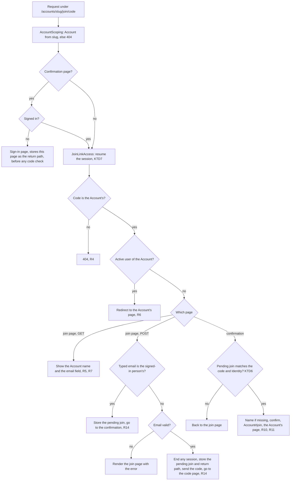
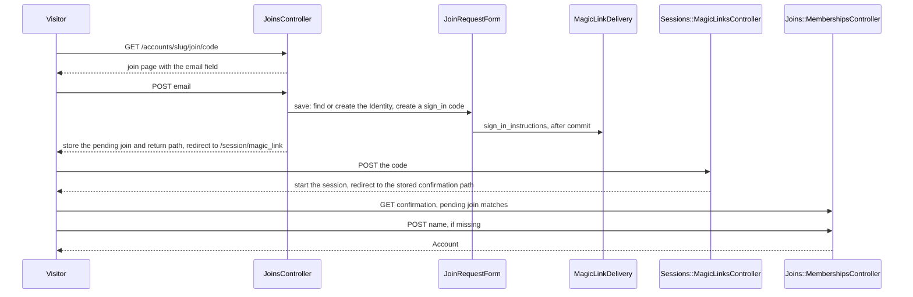

# Join an Account by Link - Plan

## Goal Capsule

- **Objective:** Residents and service providers get into their condominium's Account on their own, from a link the síndico shares, without the síndico typing anyone's email.
- **Means:** Fizzy's join link (`Account::JoinCode` and `join/:code` in basecamp/fizzy), adapted to Ermida's Account / Identity / User and its emailed sign-in code, with each piece placed by the layered-rails plan (`.compound-engineering/artifacts/plans/2026-11-06-1352-feat-join-account-by-link-layering-plan.md`) as corrected in KTD1–KTD12.
- **Authority:**
  - The Requirements win on behavior.
  - The Key Technical Decisions win on mechanism within them, and correct the layered-rails plan wherever the two differ.
  - `AGENTS.md`, `CODING_STANDARDS.md`, `Archspec.rb` and the `layered-rails` pack (`compound-packs/layered-rails/`) bind every unit.
  - Securing the link (#26), managing users and roles (#18) and requiring a name app-wide (#27) are not active scope.
- **Stop conditions:**
  - Stop and ask before changing behavior in the Requirements.
  - Stop if strong_migrations refuses the migration sequence in KTD11, rather than marking a step `safety_assured`.
  - Stop if any Archspec rule fails and the only way through is a suppression or a weaker rule.
- **Execution profile:** one pull request from the `auth-2` branch, built in dependency order U1, U2, U3, U4, U5, U6, U7, U8, U9. The share page (U3) draws the join routes and shows a link that only U6 and U7 make work, so they ship together. Each unit leaves `dip rails test` green.
- **Who finishes:** the implementer runs the Verification Contract, including the manual development check, and opens the pull request.
- **Open blockers:** none.

---

## Product Contract

### Summary

Each Account gets one join link that its owner and admins can see and copy.
Anyone who opens it proves their email with a sign-in code, gives their name if Ermida does not have it yet, confirms, and enters the Account as a member.
A person who is already signed in types their own email and skips the code, and an active user of the Account goes straight in.

### Problem Frame

Sign-up (`.compound-engineering/artifacts/plans/2026-11-05-1652-feat-account-signup-plan.md`) lets a síndico create an Account and become its owner, and nobody else has a way in.
The Account exists for the residents and service providers, so as it stands it holds one person.
Residents and service providers do not sign up (CONCEPTS.md, Sign-up); they need to join an Account that already exists.
A condominium already talks through a shared channel, usually the building's group chat, so one link posted there reaches everyone without the síndico collecting emails.

### Actors

- A1. Owner or admin: copies the Account's join link and shares it.
- A2. Signed-out visitor: opens the link, with or without an Identity in Ermida.
- A3. Signed-in person who is not an active user of the Account: opens the link while signed in.
- A4. Active user of the Account: opens the link they already used, or one forwarded to them.

### Key Decisions

- **An open join link: whoever has it joins, with no approval step.** Making the link safer is #26. Governs R1, R11. (session-settled: user-directed — chosen over a link whose joins wait for an admin's approval, over emailed invitations only, and over both a link and invitations; the user asked to ship the open link and handle security in a follow-up issue)
- **Everyone joins as a member.** A service provider becomes `provider` when #18 lets an admin change roles. Governs R11. (session-settled: user-approved — chosen over one link per role and over letting the person pick their role on joining)
- **The link never changes in this work.** If it leaks, nothing stops it until #26 adds a way to regenerate or limit it. Governs R2. (session-settled: user-directed — chosen over letting owners and admins regenerate the link now)
- **Only owners and admins see the link.** Governs R3. (session-settled: user-approved — chosen over every active user and over the owner alone)
- **The name is required on joining, and asked only when the Identity has none.** Requiring it everywhere is #27. Governs R10. (session-settled: user-directed — chosen over an optional name and over asking for the name and the unit (apartment), which would bring the unit concept into Ermida now)
- **The síndico gets no notice of who joined until #18 adds the user list.** (session-settled: user-directed — chosen over emailing owners and admins on each join and over a read-only user list in this work; there are no real users yet)
- **The link carries its own secret code, never the Account's slug alone.** The slug comes from the condominium's name and never changes, so a link built only from it could be guessed. Governs R1. (session-settled: user-approved — chosen over a join page at the Account's own address)
- **The join page always asks for an email, as Fizzy's does.** Typing the email settles which Identity joins, even on a shared device. Governs R7, R14. (session-settled: user-directed — chosen over showing the signed-in email with an action to sign out and return to the link)
- **The code email stays the existing fixed text and never names the Account.** An Account name is text anyone chooses at sign-up, and naming it in the email would let anyone send that text from Ermida to any address. Governs R9. (session-settled: user-approved — chosen over naming the Account in the email body or subject; Fizzy's code email also carries only fixed text)
- **Joining by link supersedes the sign-up plan's "residents only ever join by invitation".** Emailed invitations stay a candidate in #26.

### Requirements

**The link**

- R1. Each Account has exactly one join link, carrying a randomly generated secret code as strong as Fizzy's join code (12 base58 characters), never the 6-character sign-in code and never derived from the Account's name or slug.
- R2. The join link stays the same for the Account's whole life; nothing regenerates or expires it in this work.
- R3. Only the Account's active owner and admins can open the share page, the page inside the Account that shows the join link and lets them copy it, and they reach it from the Account's page. (pack: layered-rails, authorization-lives-in-policies.md)

**Opening the link**

- R4. A join link whose code matches no Account shows a not-found page.
- R5. Opening the link creates nothing: it shows a page naming the Account, and the person joins only by confirming on the join link's confirmation page, which also names the Account.
- R6. An active user of the Account who opens the link goes straight into the Account, and nothing is created.

**Joining**

- R7. The join page always asks for an email, and a signed-out visitor proves the typed email with a sign-in code and comes back signed in to the join link's confirmation page, whether or not Ermida already knew the email.
- R8. The join page responds the same way to an email Ermida knows and to one it does not.
- R9. The join page sends the existing sign-in code email: fixed text, the code and no link to click, with no Account name or other text a user chose. (pack: layered-rails, notifications-go-through-deliveries.md)
- R10. When the person's Identity has no name, the join page requires one before confirming, and the name is saved on the Identity.
- R11. Confirming checks the join code again, creates an active, verified `member` user in the Account that code names, and takes the person into it; knowing the Account's slug alone never lets anyone join. (pack: layered-rails, complex-input-goes-through-form-or-filter-objects.md)
- R12. A person whose earlier user in the Account was deactivated joins as a new member user, following the rule that leaving is one-way.
- R13. The join page limits code requests per IP, as the sign-in page does, and the existing per-person cap on live codes applies.
- R14. When a signed-in person types their own email, no code is needed; when they type another, their session ends and the typed email is proved with a code as in R7.

### Key Flows

- F1. Signed-out visitor joins
  - **Trigger:** A2 opens the join link from the building's group chat.
  - **Actors:** A2
  - **Steps:** The page names the Account and asks for an email. A code arrives by email. The person types the code and returns signed in to the join link's confirmation page, which names the Account. If their Identity has no name, they give one. They confirm.
  - **Outcome:** The person is a member of the Account and lands on its page.
  - **Covered by:** R5, R7, R8, R9, R10, R11
- F2. Signed-in person joins another Account
  - **Trigger:** A3, already a user of another condominium, opens the link.
  - **Actors:** A3
  - **Steps:** The page names the Account and asks for an email. They type their own, so no code is needed. If their Identity has no name, they give one. They confirm.
  - **Outcome:** The person is a member of the new Account, and both Accounts appear in their account menu.
  - **Covered by:** R5, R10, R11, R14
- F3. Síndico shares the link
  - **Trigger:** A1 wants residents to join.
  - **Actors:** A1
  - **Steps:** From the Account's page they open the share page, copy the link and post it where residents will see it.
  - **Covered by:** R1, R3

### Acceptance Examples

- AE1. **Covers R7, R10, R11.** Given ana@example.com is unknown to Ermida, when she opens Edifício Aurora's join link, proves her email with the code, gives the name "Ana" and confirms, then she has an Identity named Ana and an active, verified `member` user in Edifício Aurora, and she lands on its page.
- AE2. **Covers R10.** Given Bruno's Identity is already named "Bruno", when he joins through the link, then the page asks for no name.
- AE3. **Covers R6.** Given Carla is an active user of Edifício Aurora and signed in, when she opens its join link, then she lands on the Account's page and no user is created.
- AE4. **Covers R12.** Given Diego's user in Edifício Aurora was deactivated, when he joins through the link again, then a new active member user is created and the deactivated one stays as it was.
- AE5. **Covers R4.** Given a join link whose code belongs to no Account, when anyone opens it, then they see a not-found page.
- AE6. **Covers R5.** Given a chat app fetches the join link to build a preview, when that request arrives, then no Identity, user or code is created.
- AE7. **Covers R3.** Given Eva is an active `member` of Edifício Aurora, when she tries to open the share page, then she is refused and does not see the link.
- AE8. **Covers R8.** Given one known and one unknown email, when each is typed on the join page, then both see the same next page.
- AE9. **Covers R11.** Given Fábio is signed in and is not a user of Edifício Aurora, when he sends the confirmation with the Account's slug but no valid join code, then no user is created.
- AE10. **Covers R14.** Given Ana is signed in on a shared computer, when Bruno opens the join link and types his own email, then Ana's session ends, the code goes to Bruno, and the user created is Bruno's.

### Scope Boundaries

- Regenerating, expiring or limiting the link, approving joins, emailed invitations, and restricting the link to listed emails or units: #26.
- Listing the Account's users, removing someone, and changing a role (including making a provider `provider`): #18.
- Requiring a name for every Identity, outside joining and creating an Account: #27.
- Telling owners and admins that someone joined.
- Units (apartments) and asking for one on joining.
- A clickable link in the code email, passkeys, and a JSON or native-app flow.

### Dependencies / Assumptions

- There are no real users yet, so the open link's risk (Key Decisions) costs nothing today.
- Email does not leave the app in production yet (#21); joining works in development through `/letter_opener`, as sign-up does.

### Sources / Research

- Issue #17 (this work), with #18, #21, #26 and #27 as the surrounding work.
- `.compound-engineering/artifacts/plans/2026-11-05-1652-feat-account-signup-plan.md`: the sign-in code flow, rate limits, `AccountForm` asking for the person's name only when missing (`app/forms/account_form.rb`).
- `app/controllers/concerns/authorization.rb`: `allow_unauthorized_access`, declared for "a join link" and not yet used by any controller.
- `app/models/user.rb`: roles, `deactivate`, and one user per Identity per Account; `app/models/account.rb`: `create_with_owner`, today the only writer of `verified_at`.
- `app/views/magic_link_mailer/sign_in_instructions.*.erb`: the code email carries only the code.
- Fizzy (github.com/basecamp/fizzy) `config/routes.rb`: `account/join_code`, `get/post "join/:code"` inside `filter_path_parameters :code`, `users/joins` and `users/verifications`.
- Fizzy `app/models/account/join_code.rb`: `SecureRandom.base58(12)` in groups of four, looked up together with the Account in the URL. `app/controllers/join_codes_controller.rb`: asks for the email every time, ends a session whose Identity differs, rate-limits only the email submission (10 per 3 minutes), 404 for an unknown code. `app/views/mailers/magic_link_mailer/sign_in_instructions.*.erb`: the code email a join sends is fixed text and the code.

---

## Planning Contract

Product Contract preservation: restructured, no scope change: R5, R7 and F1 name the confirmation page under the join link. Its four questions deferred to planning are answered by KTD1 (where the join page lives), KTD6 and KTD12 (how the visitor returns after the code), KTD8 (what a refused member sees) and KTD12 (the join page reuses the sign-in code page), and they are removed from it.

### Key Technical Decisions

- KTD1. **The join page lives under the Account's prefix, at `/accounts/<slug>/join/<code>`, as Fizzy's does.** `AccountScoping` resolves the Account from the slug. `allow_unauthenticated_access` and `allow_unauthorized_access` let signed-out visitors and non-users in, and the code is checked against that Account (KTD3). The route word `join` comes after the slug, not after `/accounts/`, so `Account::RESERVED_SLUGS` and its test stay as they are. Governs R1, R4, R5. (pack: layered-rails, controllers-expose-only-crud-actions.md)
- KTD2. **The join code is a column on `accounts`, generated through an `Account::JoinCode` value object.** It holds 12 base58 characters in groups of four, about 10^21 values, and compares in constant time. Fizzy keeps its code in a separate `Account::JoinCode` table with `usage_count` and `reset`; that table earns its place when #26 adds limits and regeneration, and R2 keeps the code permanent until then. Governs R1, R2.
- KTD3. **Every join request checks the code, the confirmation included.** A controller concern, `JoinLinkAccess`, raises not found unless the code in the URL is the Account's. The Account comes from the slug and the code alone decides entry, so knowing the slug never lets anyone join. Governs R4, R11. (pack: layered-rails, authorization-lives-in-policies.md)
- KTD4. **Joining is a rule on the Account: `Account#join(identity)`.** It creates a verified `member` user, returns the existing user for an active one, refuses a nil Identity (which would otherwise find the Account's `system` user), and re-finds the user when a concurrent confirmation won the unique index. Governs R6, R11, R12. (pack: layered-rails, domain-logic-lives-in-models.md)
- KTD5. **Two form objects take the input: `JoinRequestForm` for the email step, `JoinForm` for the confirmation.** `JoinRequestForm` repeats `SignupForm`'s steps with purpose `sign_in`, so the code page returns to the stored path instead of the new-Account form, and the email stays the fixed code email (R9). `JoinForm` follows `AccountForm`: it asks for the name only when missing and copies Identity errors onto `person_name`. Governs R7, R8, R9, R10, R11. (pack: layered-rails, complex-input-goes-through-form-or-filter-objects.md; pack: layered-rails, notifications-go-through-deliveries.md)
- KTD6. **The confirmation opens only for the email typed on this device for this link.** The email step stores a pending join (code and email) in the session, and the confirmation redirects to the join page unless the pending join matches the code and the signed-in Identity. It is cleared after joining. Without it, opening the confirmation URL directly, or inheriting another person's stored return path on a shared device, would confirm a join without typing an email. The pending join and the return path live in the cookie session, which survives `terminate_session` and `start_new_session_for` (neither calls `reset_session`): F1 depends on that, since the pending join is written before the code page and read after it, so sign-in must not start calling `reset_session`. The email match is what makes the surviving state safe. After `terminate_session`, the email step reads nothing from `Current`, whose `||=` would still hold the destroyed session. Governs R7, R14.
- KTD7. **Join pages resume the session explicitly, before any check.** A page that declares both `allow_unauthenticated_access` and `allow_unauthorized_access` runs nothing that loads the session, so `Current.identity` and `Current.user` would stay nil. Action Policy also memoizes the authorization context on first use (`@_authorization_context ||=` in action_policy 0.7.8). `JoinLinkAccess` therefore resumes the session as its first `before_action`. Governs R6, R14.
- KTD8. **The share page is the first role-based rule, in `AccountPolicy`; a refused page inside an Account goes back to the Account's page.** `User#administrator?` says what running the condominium means (owner or admin). `AccountPolicy#share?` requires it, and `AccountPolicy#join?` admits only people who are not active users of the Account. The `Authorization` concern rescues `ActionPolicy::Unauthorized` and redirects to the Account's root with an alert, which today ends in a 500. Governs R3, R6. (pack: layered-rails, authorization-lives-in-policies.md)
- KTD9. **Archspec keeps role checks inside policies.** `presentation.cannot_call :administrator?, :owner?, :admin?`. The list leaves out `member?` and `provider?`, because `Set#member?` and `Hash#member?` share those names and the rule cannot tell receivers apart. ERB views are not analyzed, so templates ask through `allowed_to?`. Governs R3.
- KTD10. **The join code stays out of Rails' logs: parameters, model inspection, redirect locations and the production request line.**
  - `config.filter_parameters` gains `/\Acode\z/`, an exact match, since a bare `:code` would also filter `postcode` and `country_code`. Path parameters are filtered in the parameters hash, and so is the 6-character sign-in code posted to the code page.
  - `config.filter_parameters` also gains `:join_code` for request parameters. `Account` itself declares `self.filter_attributes += %i[join_code]`, because in this app the initializer's list never reaches Active Record: `ActiveRecord::Base.filter_attributes` is empty in development and test, and `Identity#inspect` prints the email today. The model declaration does not depend on load order.
  - `config.filter_redirect` gains `%r{/join/}`. The code page's sign-in redirect lands on a join path, and Lograge logs that redirect's `location`.
  - Lograge's `custom_options` replaces `path` with the path scrubbed by a small `JoinLinkLogFilter` in `lib/`, because `request.filtered_path` filters only the query string. The scrubber lives in `lib/` because Lograge is in the production Gemfile group only, so tests cannot load it.
  - Lograge silences Rails' `Started GET` line in production; development still prints it, on the developer's machine.
  - Thruster, which fronts Rails in the production image (`Dockerfile` runs `./bin/thrust`), logs every request by default; `THRUSTER_LOG_REQUESTS=false` silences it, since Lograge already writes one line per request.
  - kamal-proxy's access log, outside the app container, keeps the raw path (Risks & Dependencies).
  (session-settled: user-directed — chosen over filtering only the parameters and leaving the code in the request path)
- KTD11. **Four migrations add the column under strong_migrations' safe sequence, shipped in one deploy.**
  1. Add a nullable `join_code` with a `join_code IS NOT NULL` check constraint, added unvalidated.
  2. Backfill existing Accounts in a `disable_ddl_transaction!` migration, through a model class defined inside the migration. The migration-local model is required: `Account`'s `validates_db_uniqueness_of :join_code` looks up a unique index that does not exist yet. The backfill updates only rows `where(join_code: nil)`, one at a time in batches with `update_columns` (each row needs its own random code, and `updated_at` stays as it was), and ends by checking that no row is left NULL.
  3. In a transaction: validate the constraint, `change_column_null false`, drop the constraint.
  4. Alone, under `disable_ddl_transaction!`: add the unique index with `algorithm: :concurrently`. A failed concurrent build leaves an INVALID index, and `remove_invalid_indexes` is off in `config/initializers/strong_migrations.rb`, so keeping it alone makes a rerun clean.

  Each migration has explicit `up` and `down` with `if_exists` / `if_not_exists`, since `validate_check_constraint` cannot be reversed and `remove_check_constraint` needs its expression to reverse. One deploy is safe only because nothing is deployed yet (`config/deploy.yml` holds a placeholder host): once Accounts are created in production, migration 1's constraint would reject inserts from the old code still serving, and the work would split into two deploys (Risks & Dependencies). strong_migrations checks every migration after `start_after = 20261104204238`, and no migration in the repo uses the check-constraint route yet. After migrating, restore `db/cable_schema.rb`, `db/cache_schema.rb` and `db/queue_schema.rb` (`.compound-engineering/artifacts/solutions/developer-experience/migrate-rewrites-solid-schema-dumps.md`).
- KTD12. **The join flow reuses the sign-in code page.** Two changes make that work from inside an Account:
  - `Authentication::ViaMagicLink#redirect_to_session_magic_link` builds the code page path with `script_name: nil`. Today it keeps the slug, and the code page (`disallow_account_scope`) sends the person to `/`.
  - `Authentication` gains `return_after_authenticating_to(path)`, so the email step stores the confirmation page as the return path that `after_authentication_url` already reads. It takes only paths the app built with a url helper, never anything from `params`; `load_defaults 8.1` also keeps `raise_on_open_redirects` on.

  Governs R7.

### High-Level Technical Design

Where each piece lives, by layer. Each arrow is a call.



What each request to a join link does, in order.



F1 across the pages, signed out.



### Assumptions

- `acts_as_tenant` scopes `User` to `Current.account`, which on every join request is the Account the code was checked against, so `Account#join` needs no `with_tenant` block.
- Rails' default `rate_limit` key is `request.remote_ip`, and Rails trusts private-range proxies by default, so behind kamal-proxy it should resolve to the visitor. Unverified until the proxy is configured (`config/deploy.yml` has it commented out).

### Research

- Session and authorization context on pages that skip both checks: `app/controllers/concerns/authentication.rb` (`resume_session`), `app/controllers/concerns/authorization.rb` (`account_access?` calls `authenticated?`), action_policy 0.7.8 `@_authorization_context ||=`.
- `verify_authorized` is an `after_action` that only `authorize!` satisfies, and it does not run after a halted `before_action` or a rescued exception (action_policy 0.7.8).
- Lograge 0.15.1 merges `custom_options` last, so a returned `path` replaces its own. Rails 8.1 puts `request` in the `process_action` payload. DebugExceptions logs `No route matches [GET] "<raw path>"` for an unmatched route, so the join route stays permissive and the controller validates the code.
- Lograge is in the `:production` Gemfile group (`Gemfile`), so it never loads in tests.
- strong_migrations 2.8.0 accepts `change_column_null ..., false` only after a validated `IS NOT NULL` check constraint.
- `SecureRandom.base58` is Active Support's, case-sensitive, with an alphabet that leaves out `0`, `O`, `I` and `l`.
- Controller tests use literal paths, since url helpers keep the slug after a request inside an Account (`test/controllers/landings_controller_test.rb`).
- A fresh worktree needs `dip bun install --frozen-lockfile` before tests (`.compound-engineering/artifacts/solutions/developer-experience/fresh-worktree-test-run-oom-killed-by-vite-build.md`).

### System-Wide Impact

- **Every controller:** the `Authorization` concern's new `rescue_from ActionPolicy::Unauthorized` (KTD8) turns any refused `authorize!` into a 303 to the current Account's root, or `/` outside one. A missing `authorize!` still raises `ActionPolicy::UnauthorizedAction` (U3).
- **Sign-in and sign-up:** both call the changed `redirect_to_session_magic_link` (KTD12). Their redirect stays `/session/magic_link`, since they run outside any Account.
- **The code page:** `/\Acode\z/` also filters the 6-character sign-in code from the parameters line (KTD10). Any future parameter named exactly `code` is filtered too.
- **The cookie session:** it now carries `pending_join` beside `return_to_after_authenticating`, and both survive sign-out and sign-in by design (KTD6).
- **Forgery protection:** the join controllers keep `protect_from_forgery`; none adds `skip_forgery_protection`. The session cookie stays `same_site: :lax`.
- **Signed-out pages that create Identities:** the join page joins sign-up as a page that creates an Identity and sends a code email for any address (Risks & Dependencies).

### Risks & Dependencies

| Risk | Decision |
|---|---|
| The open, permanent link lets anyone who has it join, with no notice to the síndico | Accepted product risk until #26 and #18 (Key Decisions) |
| One IP can trigger about 30 code emails every 3 minutes across sign-in, sign-up and join, since each controller counts separately | Accepted: each address is still capped at 5 codes per 15 minutes (`MagicLink::ISSUE_LIMIT`) |
| kamal-proxy's access log records the raw request path, code included | Accepted until #26 adds regeneration; Rails' own logs are filtered (KTD10) |
| `assume_ssl` and `force_ssl` are off, so the share page could produce an `http://` link that gets posted permanently | Dependency: HTTPS is on before going live, alongside production email (#21) |
| Migration 1's constraint rejects inserts from old code still serving | Accepted for one deploy because nothing is deployed yet; split into two deploys if Accounts exist in production first (KTD11) |

---

## Implementation Units

### U1. The join code in the domain

- **Goal:** every Account carries a strong, unique join code from its creation, including the Accounts that exist today.
- **Requirements:** R1, R2; KTD2, KTD11.
- **Dependencies:** none.
- **Files:**
  - `app/models/account/join_code.rb` (new)
  - `app/models/account.rb`
  - `db/migrate/*_add_join_code_to_accounts.rb`, `db/migrate/*_backfill_accounts_join_code.rb`, `db/migrate/*_make_accounts_join_code_not_null.rb`, `db/migrate/*_add_index_to_accounts_join_code.rb` (new)
  - `db/schema.rb`
  - `test/models/account/join_code_test.rb` (new), `test/models/account_test.rb`
- **Approach:**
  1. Add the value object, following `MagicLink::Code`.
  2. Generate the code on the Account in a `before_validation ... on: :create` transformer, add `join_code?(input)`, and declare `join_code` in `filter_attributes` (KTD10).
  3. Write the four migrations in KTD11's order, then restore the Solid schema files.
  4. Leave `test/factories/accounts.rb` and `db/seeds.rb` alone: factories create Accounts through the callback, there are no record fixtures, and nothing bypasses callbacks with `insert_all`.
- **Patterns to follow:** `app/models/magic_link/code.rb` (value object), `MagicLink#generate_code` (transformer callback), `validates_db_uniqueness_of :slug` in `app/models/account.rb`.

**Layered-rails placement: Phase 1, Change 1 (a value object for the join code)**

Current:
```ruby
# app/models/magic_link/code.rb, the only code generator today
class MagicLink::Code < Data.define(:value)
  LENGTH = 6
  # ...
  def self.generate = new(SecureRandom.alphanumeric(LENGTH, chars: ALPHABET))
end
```

After:
```ruby
# A join link's secret: 12 base58 characters in groups of four, as in Fizzy (about 10^21 values), so a link that
# never changes cannot be guessed (R1).
class Account::JoinCode < Data.define(:value)
  LENGTH = 12

  def self.generate = new(SecureRandom.base58(LENGTH).scan(/.{4}/).join("-"))

  # Constant time, so response timing does not tell a guesser how much of a code is right.
  def matches?(input) = ActiveSupport::SecurityUtils.secure_compare(value, input.to_s)

  def to_s = value
end
```

Pattern: Value Objects (layered-rails `references/patterns/value-objects.md`), for "attributes with behavior (formatting, validation, comparison)", following `MagicLink::Code`.
Scenario: none.

**Layered-rails placement: Phase 1, Change 2 (an Account gets its join code when created)**

Current:
```ruby
class Account < ApplicationRecord
  # ...
  validates_db_uniqueness_of :slug
```

After:
```ruby
class Account < ApplicationRecord
  # ...
  validates_db_uniqueness_of :slug
  validates_db_uniqueness_of :join_code

  # Model inspection does not print the code (KTD10).
  self.filter_attributes += %i[join_code]

  before_validation :generate_join_code, on: :create

  def join_code?(input) = Account::JoinCode.new(join_code).matches?(input)

  private

  def generate_join_code
    self.join_code ||= Account::JoinCode.generate.to_s
  end
end
```

The callback is a transformer (5/5), like `MagicLink#generate_code`, so it stays on the model. The migrations follow KTD11, and the backfill generates codes inline (`SecureRandom.base58(12)` in groups of four) instead of calling the value object, so the migration does not depend on app code.

Pattern: Callbacks, transformer kept (layered-rails `references/topics/callbacks.md`).
Scenario: none.

- **Test scenarios:**
  - `Account::JoinCode.generate` returns three groups of four base58 characters joined by dashes.
  - Two generated codes differ.
  - `matches?` is true for the same value and false for another code, an empty string and nil.
  - Creating an Account sets a join code in that format.
  - An Account created with a join code already set keeps it.
  - `join_code?` is true for the Account's own code and false for another Account's code.
  - Two Accounts never share a join code: saving a duplicate gives a validation error, not a database error.
  - After the migrations, an Account created before them has a join code, and the column is `NOT NULL` with a unique index.
  - Each migration rolls back with `dip rails db:rollback:primary` and runs again cleanly.
- **Verification:** model tests pass, `db/schema.rb` shows the `NOT NULL` column and unique index, and the Solid schema files are unchanged.

### U2. Joining is a rule on the Account

- **Goal:** `Account#join(identity)` turns a person into a verified member, or returns their existing active user.
- **Requirements:** R6, R11, R12; KTD4.
- **Dependencies:** none.
- **Files:** `app/models/account.rb`, `test/models/account_test.rb`.
- **Approach:**
  1. Return the active user for that Identity when one exists.
  2. Otherwise create a `member` user with `verified_at` set.
  3. Refuse a nil Identity.
  4. When the create loses a concurrent race on the unique index (`identity_id` taken), return the user that won.
- **Patterns to follow:** `Account.create_with_owner` (users created through the association), `Identity.find_or_create_by_email_address` (re-finding after a `taken` error).

**Layered-rails placement: Phase 1, Change 3 (joining is a rule of the Account)**

Current:
```ruby
def self.create_with_owner(name:, owner:)
  transaction do
    create!(name:).tap do |account|
      account.users.create!(role: :system)
      account.users.create!(role: :owner, identity: owner, verified_at: Time.current)
    end
  end
end
```

After (with research's guard and race handling):
```ruby
# A person joins as a member, verified by the code they typed (R11). One who is already an active user stays as they
# are (R6). One whose user was deactivated gets a new user, since leaving is one-way (R12).
def join(identity)
  raise ArgumentError, "joining needs a person" if identity.nil?

  users.active.find_by(identity:) || users.create!(identity:, role: :member, verified_at: Time.current)
rescue ActiveRecord::RecordInvalid => error
  raise unless error.record.errors.of_kind?(:identity_id, :taken)

  users.active.find_by!(identity:)
end
```

Pattern: Domain logic lives in models (pack: layered-rails, domain-logic-lives-in-models.md).
Scenario: none.

- **Test scenarios:**
  - Covers AE1. An Identity with no user in the Account gets an active `member` user with `verified_at` set.
  - Covers AE3. An Identity that is already an active user gets that same user back, and no user is created.
  - An Identity that is already an active `owner` keeps the owner role.
  - Covers AE4. An Identity whose earlier user was deactivated gets a new active member user, and the deactivated one is unchanged.
  - A nil Identity raises `ArgumentError` and does not return the Account's `system` user.
  - When an active user for that Identity is created between the lookup and the create, `join` returns that user instead of raising.
  - An inactive user that still holds the Identity (a state only a write outside `deactivate` produces) makes `join` raise `ActiveRecord::RecordNotFound` rather than reactivate it; `deactivate` stays the only way a user leaves.
- **Verification:** model tests pass.

### U3. The share page behind AccountPolicy

- **Goal:** owners and admins see the join link on a share page, and anyone refused a page inside an Account goes back to the Account's page.
- **Requirements:** R3, R6; F3; AE7; KTD8.
- **Dependencies:** U1.
- **Files:**
  - `app/models/user.rb`
  - `app/policies/account_policy.rb`
  - `app/controllers/shares_controller.rb` (new), `app/views/shares/show.html.erb` (new)
  - `app/controllers/concerns/authorization.rb`
  - `app/views/landings/show.html.erb`
  - `app/javascript/controllers/clipboard_controller.js` (new)
  - `config/routes.rb`, `config/locales/en.yml`
  - `test/models/user_test.rb`, `test/policies/account_policy_test.rb`, `test/controllers/shares_controller_test.rb` (new), `test/controllers/concerns/authorization_test.rb`
- **Approach:**
  1. Add `User#administrator?`.
  2. Add `AccountPolicy#share?` and `#join?`.
  3. Add the share route, controller and view. The view shows the full link as selectable text with a copy button wired to a new `clipboard` Stimulus controller, which copies the link and shows a short "Copied" confirmation. No fallback for a missing Clipboard API: it needs a secure context, and HTTPS before going live is a listed dependency.
  4. Draw the join routes here too (Phase 3, Change 2's routes, under U6), because the share view's `join_url` needs the named route. They stay permissive on `:code` (Research's note on `No route matches`) and lead nowhere until U6 and U7 add their controllers.
  5. Add the refusal handler to `Authorization`.
  6. Link the landing page to the share page only when `allowed_to?(:share?, @account)`.
- **Patterns to follow:** `LandingsController` (`verify_authorized`, `authorize! Current.account`), `test/policies/account_policy_test.rb`, `test/controllers/concerns/authorization_test.rb` (probe controllers with literal paths).

**Layered-rails placement: Phase 2, Change 1 (what running the condominium means, on the User)**

Current:
```ruby
enum :role, %w[member provider admin owner system].index_by(&:itself), default: :member, validate: true
```

After:
```ruby
enum :role, %w[member provider admin owner system].index_by(&:itself), default: :member, validate: true

# Owners and admins run the condominium.
def administrator? = owner? || admin?
```

Pattern: Domain logic lives in models (pack: layered-rails, domain-logic-lives-in-models.md).
Scenario: none.

**Layered-rails placement: Phase 2, Change 2 (the share and join rules in AccountPolicy)**

Current:
```ruby
class AccountPolicy < ApplicationPolicy
  def index? = true

  def create? = true

  # Only the account's active users get in.
  def show? = user.present? && user.active? && user.account_id == record.id
end
```

After:
```ruby
class AccountPolicy < ApplicationPolicy
  def index? = true

  def create? = true

  # Only the account's active users get in.
  def show? = user.present? && user.active? && user.account_id == record.id

  # Only owners and admins see the join link (R3).
  def share? = show? && user.administrator?

  # Joining is for people who are not yet active users of the account; those go straight in (R6).
  def join? = !show?
end
```

Pattern: Policy Objects (layered-rails `references/patterns/policy-objects.md`).
Scenario: Extract Authorization to Policy (layered-rails `examples/authorization-to-policy.md`).

**Layered-rails placement: Phase 2, Change 3 (the share page)**

Current: none; the landing page links only to the account menu and sign-out.

After:
```ruby
# config/routes.rb
resource :share, only: :show

# app/controllers/shares_controller.rb
# The share page: the account's join link, for its owners and admins (R3).
class SharesController < ApplicationController
  verify_authorized

  def show
    @account = Current.account
    authorize! @account, to: :share?
  end
end
```

The view shows `join_url(code: @account.join_code)`.

Pattern: Policy Objects (layered-rails `references/patterns/policy-objects.md`).
Scenario: Extract Authorization to Policy (layered-rails `examples/authorization-to-policy.md`).

**Layered-rails placement: Phase 2, Change 4 (a refused page inside an Account goes back to the Account's page)**

Current:
```ruby
included do
  before_action :ensure_account_access, if: :account_access?
end
```

After:
```ruby
included do
  before_action :ensure_account_access, if: :account_access?
  rescue_from ActionPolicy::Unauthorized, with: :deny_access
end

# ...

# A user refused one page of their account (a member on the share page, AE7) goes back to the account's page.
def deny_access
  redirect_to root_path, alert: t("authorization.denied"), status: :see_other
end
```

Outside an Account, `root_path` is `/`, which leads to the account menu.

Pattern: Policy Objects (layered-rails `references/patterns/policy-objects.md`).
Scenario: Extract Authorization to Policy (layered-rails `examples/authorization-to-policy.md`).

- **Test scenarios:**
  - `User#administrator?` is true for `owner` and `admin`, and false for `member`, `provider` and `system`.
  - `share?` allows an active owner and an active admin of the Account.
  - `share?` refuses a member and a provider of the Account, an admin of another Account, a deactivated admin, and a nil user.
  - `join?` refuses an active user of the Account, and allows a nil user, a user of another Account and a deactivated user.
  - An owner who opens `/accounts/edificio-aurora/share` sees the join link, and the link contains the Account's join code.
  - Covers AE7. A member who opens `/accounts/edificio-aurora/share` is redirected to `/accounts/edificio-aurora/` with the denial alert and does not see the code.
  - A probe page that raises `ActionPolicy::Unauthorized` inside an Account redirects to that Account's root with 303, not a 500.
  - A refused POST returns 303 and writes nothing.
  - A probe controller with `verify_authorized` that never calls `authorize!` still raises `ActionPolicy::UnauthorizedAction`, so the new rescue does not hide a missing check. Confirm in action_policy 0.7.8 that `UnauthorizedAction` is not a subclass of `Unauthorized`; if it is, rescue only the policy-refusal class.
  - The landing page shows the share link to an owner and hides it from a member.
- **Verification:** policy, controller and concern tests pass. The share page works in development for an owner who signed up there (`db/seeds.rb` creates no Accounts).

### U4. Archspec keeps role checks inside policies

- **Goal:** controllers, forms and components cannot read a role directly.
- **Requirements:** R3; KTD9.
- **Dependencies:** U3.
- **Files:** `Archspec.rb`.
- **Approach:**
  1. Add the rule.
  2. Run `dip archspec check`.
  3. Confirm the rule bites: add a throwaway `Current.user.owner?` call to a controller, check that `dip archspec check` fails on it, then remove the call.

**Layered-rails placement: Phase 2, Change 5 (lock role checks inside policies)**

Current: no rule on roles.

After (narrowed by research, KTD9):
```ruby
# Who may do what is a policy's decision: controllers, forms and components never read a role
presentation.cannot_call :administrator?, :owner?, :admin?,
  because: "role checks live in app/policies/"
```

Pattern: Policy Objects (layered-rails `references/patterns/policy-objects.md`); ArchSpec setup (layered-rails `workflows/archspec.md`).
Scenario: none.

- **Test expectation:** none, since this is static configuration. The throwaway probe in the Approach proves the rule.
- **Verification:** `dip archspec check` passes on the branch and fails on the probe.

### U5. The code page works from inside an Account

- **Goal:** a page under an Account's prefix can send a person through the sign-in code page and say where to return afterwards.
- **Requirements:** R7; KTD12.
- **Dependencies:** none.
- **Files:**
  - `app/controllers/concerns/authentication/via_magic_link.rb`
  - `app/controllers/concerns/authentication.rb`
  - `test/controllers/sessions/magic_links_controller_test.rb`
  - `test/controllers/sessions_controller_test.rb`
- **Approach:**
  1. Build the code page path with `script_name: nil`.
  2. Add `return_after_authenticating_to(path)` next to `request_authentication`, the only other writer of `session[:return_to_after_authenticating]`.
- **Patterns to follow:** `request_authentication` and `after_authentication_url` in `app/controllers/concerns/authentication.rb`.

**Layered-rails placement: Phase 3, Change 1 (the code page works from inside an Account, and the join page can say where to return)**

Current:
```ruby
# via_magic_link.rb
def redirect_to_session_magic_link(email_address, magic_link)
  remember_pending_authentication(email_address)
  flash[:magic_link_code] = magic_link.code if magic_link && AuthenticationConfig.show_code_on_page?
  redirect_to session_magic_link_path, status: :see_other
end

# authentication.rb, the only writer of the return path
def request_authentication
  if request.get? && request.fullpath.bytesize <= 1.kilobyte
    session[:return_to_after_authenticating] = request.fullpath
  end
  redirect_to new_session_path(script_name: nil)
end
```

After:
```ruby
# via_magic_link.rb: the code page belongs to no account, so the slug never goes with it
redirect_to session_magic_link_path(script_name: nil), status: :see_other

# authentication.rb
# Where signing in returns to, for a page that sends the person through the code page itself.
def return_after_authenticating_to(path)
  session[:return_to_after_authenticating] = path
end
```

Pattern: Specification test, with HTTP and session concerns kept in controllers (layered-rails `references/core/specification-test.md`).
Scenario: none.

- **Test scenarios:**
  - Sign-in and sign-up still redirect to `/session/magic_link`, unchanged.
  - A probe page under `/accounts/edificio-aurora/` that calls `redirect_to_session_magic_link` redirects to `/session/magic_link` without the slug.
  - After a page stores `/accounts/edificio-aurora/join/<code>/membership/new` as the return path, typing a valid sign-in code redirects there.
- **Verification:** the existing sessions, sign-up and code page tests still pass, plus the new ones.

### U6. The join page and the email step

- **Goal:** opening a join link shows the Account and an email field. Submitting it sends a code to a new or known email, or goes straight to the confirmation for the signed-in person's own email.
- **Requirements:** R4, R5, R6, R7, R8, R9, R13, R14; F1, F2; AE3, AE5, AE6, AE8, AE10; KTD1, KTD3, KTD5, KTD6, KTD7.
- **Dependencies:** U1, U3, U5.
- **Files:**
  - `app/controllers/concerns/join_link_access.rb` (new)
  - `app/controllers/joins_controller.rb` (new), `app/views/joins/show.html.erb` (new)
  - `app/forms/join_request_form.rb` (new)
  - `config/locales/en.yml`
  - `test/forms/join_request_form_test.rb` (new), `test/controllers/joins_controller_test.rb` (new)
- **Approach:**
  1. Use the join routes U3 drew.
  2. Add `JoinLinkAccess`, whose `before_action`s run in this order: resume the session (KTD7), require the join code (KTD3), send an active user into the Account (R6). It also stores and reads the pending join (KTD6).
  3. Add `JoinRequestForm` (KTD5).
  4. Add `JoinsController`. In `create`:
     - the signed-in person's own email stores the pending join and goes to the confirmation;
     - any other email is saved first, and only after a successful save does the controller end an existing session, store the pending join and the return path, and send the person to the code page, so a typo never signs anyone out;
     - an invalid email re-renders the join page.
  5. Add the view: the Account's name, the email field through `FormField::Component`, and the submit button.
- **Execution note:** start with the controller test for AE3 (a signed-in active user opens the link and lands in the Account). It fails unless the session is resumed before the checks.
- **Patterns to follow:** `SignupForm` and `SignupsController` (email step, `redirect_to_session_magic_link`, rate limit with a redirecting handler), `test/controllers/signups_controller_test.rb` (rate-limit test with `Prosopite.pause`), `test/controllers/landings_controller_test.rb` (literal paths).

**Layered-rails placement: Phase 3, Change 2 (the join routes and the code check)**

Current: none.

After (with research's session resume and pending join, KTD6 and KTD7):
```ruby
# config/routes.rb
# A join link: /accounts/<slug>/join/<code>. The code is the secret (R1); no word is added under /accounts/.
get "join/:code", to: "joins#show", as: :join
post "join/:code", to: "joins#create"
scope "join/:code", module: :joins, as: :join do
  resource :membership, only: %i[new create]
end

# app/controllers/concerns/join_link_access.rb
# Pages behind a join link. They let in people who are not users of the account, so each checks that the code in
# the URL is the account's on every request, the confirmation included (R4, R11).
module JoinLinkAccess
  extend ActiveSupport::Concern

  included do
    allow_unauthorized_access
    before_action :resume_session
    before_action :require_join_code
    before_action :enter_account_as_user
  end

  private

  def require_join_code
    raise ActiveRecord::RecordNotFound unless Current.account.join_code?(params[:code])
  end

  # An active user of the account goes straight in (R6).
  def enter_account_as_user
    redirect_to root_path if allowed_to?(:show?, Current.account)
  end

  # The email typed on this device for this link; the confirmation opens only for it (KTD6).
  def remember_pending_join(email_address)
    session[:pending_join] = {"code" => params[:code], "email_address" => email_address}
  end

  def pending_join_for?(identity)
    pending = session[:pending_join] || {}
    pending["code"] == params[:code] && pending["email_address"] == identity&.email_address
  end

  def forget_pending_join
    session.delete(:pending_join)
  end
end
```

Pattern: Policy Objects, with authentication separate from authorization (layered-rails `references/patterns/policy-objects.md`).
Scenario: none.

**Layered-rails placement: Phase 3, Change 3 (the email step through a form object)**

Current:
```ruby
# app/forms/signup_form.rb: the same steps, with purpose sign_up
def submit!
  @identity = Identity.find_or_create_by_email_address(email_address)

  if identity.persisted?
    @magic_link = identity.create_magic_link(purpose: :sign_up)
  else
    raise ActiveRecord::RecordInvalid, identity
  end
end
```

After (with research's save-before-sign-out order):
```ruby
# app/forms/join_request_form.rb
# The join page's email step (R7): sends a sign-in code to the email, creating the person when the email is new,
# so the page answers the same for a known and an unknown email (R8). Purpose sign_in, so the code page returns to
# the confirmation instead of the new-account form, and the email is the fixed code email (R9).
class JoinRequestForm < ApplicationForm
  attribute :email_address, :string

  attr_reader :identity, :magic_link

  after_commit :deliver_code

  def email_address = Identity.normalize_value_for(:email_address, super)

  def from?(identity) = identity.present? && identity.email_address == email_address

  def save
    super
  rescue ActiveRecord::RecordInvalid => error
    errors.merge!(error.record.errors)
    false
  end

  private

  def submit!
    @identity = Identity.find_or_create_by_email_address(email_address)

    if identity.persisted?
      @magic_link = identity.create_magic_link(purpose: :sign_in)
    else
      raise ActiveRecord::RecordInvalid, identity
    end
  end

  def deliver_code
    if magic_link
      MagicLinkDelivery.sign_in_instructions(magic_link).deliver_later
    end
  end
end

# app/controllers/joins_controller.rb
# A join link's page (R5): names the account and always asks for an email (R7). Opening it creates nothing.
class JoinsController < ApplicationController
  include Authentication::ViaMagicLink
  include JoinLinkAccess

  allow_unauthenticated_access
  rate_limit to: 10, within: 3.minutes, only: :create, with: :rate_limit_exceeded
  verify_authorized

  def show
    authorize! Current.account, to: :join?
    @join_request = JoinRequestForm.new
  end

  def create
    authorize! Current.account, to: :join?
    @join_request = JoinRequestForm.new(join_request_params)

    if @join_request.from?(Current.identity)
      remember_pending_join(@join_request.email_address)
      redirect_to new_join_membership_path(params[:code]), status: :see_other
    elsif @join_request.save
      send_code
    else
      render :show, status: :unprocessable_content
    end
  end

  private

  def join_request_params = params.expect(join_request: [:email_address])

  # Another person's email ends the session on this device before the code goes out (R14).
  def send_code
    terminate_session if authenticated?
    remember_pending_join(@join_request.email_address)
    return_after_authenticating_to new_join_membership_path(params[:code])
    redirect_to_session_magic_link(@join_request.email_address, @join_request.magic_link)
  end

  def rate_limit_exceeded
    redirect_to join_path(params[:code]), alert: t("sessions.rate_limited"), status: :see_other
  end
end
```

`JoinRequestForm` repeats `SignupForm`'s steps with another purpose; Scope Boundaries (planning) says why they stay two classes.

Pattern: Form Objects (layered-rails `references/patterns/form-objects.md`); notifications through deliveries (pack: layered-rails, notifications-go-through-deliveries.md).
Scenario: Form Object for Complex Input (layered-rails `examples/complex-input-to-form-object.md`).

- **Test scenarios:**
  - `JoinRequestForm` with an unknown email creates the Identity and a `sign_in` code, and enqueues one code email.
  - `JoinRequestForm` with a known email creates a `sign_in` code for that Identity without a second Identity.
  - `JoinRequestForm` with a malformed email fails with an error on `email_address`, creates nothing and sends no email.
  - `JoinRequestForm` normalizes `" Ana@Example.com "` and `from?` matches the Identity `ana@example.com`.
  - When the Identity has reached its code limit, the form still saves, creates no code and sends no email.
  - Covers AE6. A signed-out GET of the join link renders the Account's name and the email field, and creates no Identity, user or code.
  - Covers AE5. A GET or POST with a code that is not the Account's returns 404.
  - A join path without the slug (`/join/<code>`) goes to the account menu, as every account page does.
  - Covers AE3. A signed-in active user of the Account who opens the join link is redirected to `/accounts/edificio-aurora/` and no user is created.
  - Covers AE8. POSTs with a known and an unknown email both redirect to `/session/magic_link`, and both store the confirmation as the return path.
  - A signed-in non-user who types their own email is redirected to the confirmation, stays signed in, and gets no code email.
  - Covers AE10. A signed-in person who types another email has their session ended, and the code goes to the typed email.
  - After that, the old `session_id` cookie no longer authenticates: a request with it to an account page goes to sign-in.
  - A signed-in person who types a malformed email stays signed in and sees the error.
  - The eleventh POST from one IP within 3 minutes redirects back to the join page with the rate-limit alert.
- **Verification:** form and controller tests pass, and the join page works in development from the share page's link.

### U7. The confirmation

- **Goal:** a signed-in person whose pending join matches the link gives their name if missing, confirms, and lands in the Account as a member.
- **Requirements:** R10, R11, R12; F1, F2; AE1, AE2, AE4, AE9; KTD3, KTD4, KTD5, KTD6.
- **Dependencies:** U2, U6.
- **Files:**
  - `app/forms/join_form.rb` (new)
  - `app/controllers/joins/memberships_controller.rb` (new), `app/views/joins/memberships/new.html.erb` (new)
  - `config/locales/en.yml`
  - `test/forms/join_form_test.rb` (new), `test/controllers/joins/memberships_controller_test.rb` (new)
- **Approach:**
  1. Add `JoinForm` (KTD5), copying errors the way `AccountForm#copy_errors_from` does: Identity errors on `person_name`, the rest on `base`.
  2. Add the controller. Session is required (the default `require_authentication`). A pending join that does not match sends the person back to the join page (KTD6), and the pending join is cleared after a successful join.
  3. Add the view: the Account's name, the signed-in email, the name field only when `person_name_needed?`, and one confirm button.
- **Patterns to follow:** `AccountForm` and `AccountsController` (`person_name_needed?`, `copy_errors_from`, `identity.restore_attributes`), `app/views/accounts/new.html.erb`.

**Layered-rails placement: Phase 3, Change 4 (the confirmation through a form object)**

Current:
```ruby
# app/forms/account_form.rb: the pattern this follows (asks for the name only when missing)
validates :person_name, presence: true, if: :person_name_needed?

def person_name_needed? = identity.name.blank?

def submit!
  identity.update!(name: person_name) if person_name_needed?
  @account = Account.create_with_owner(name:, owner: identity)
end
```

After (with research's error mapping and pending-join check):
```ruby
# app/forms/join_form.rb
# Confirming a join: saves the person's name when Ermida has none (R10) and makes them a member (R11).
class JoinForm < ApplicationForm
  attribute :person_name, :string

  attr_accessor :account, :identity
  attr_reader :user

  validates :person_name, presence: true, if: :person_name_needed?

  def person_name_needed? = identity.name.blank?

  def save
    super
  rescue ActiveRecord::RecordInvalid => error
    identity.restore_attributes
    copy_errors_from(error.record)
    false
  end

  private

  def submit!
    identity.update!(name: person_name) if person_name_needed?
    @user = account.join(identity)
  end

  def copy_errors_from(record)
    attribute = record.is_a?(Identity) ? :person_name : :base
    record.errors.each { |error| errors.add(attribute, error.type, **error.options) }
  end
end

# app/controllers/joins/memberships_controller.rb
# The confirmation (R11). It needs a session, which the code page started (R7) or the person already had (R14),
# and a pending join for this link and this person (KTD6).
class Joins::MembershipsController < ApplicationController
  include JoinLinkAccess

  before_action :require_pending_join
  verify_authorized

  def new
    authorize! Current.account, to: :join?
    @join = JoinForm.new(account: Current.account, identity: Current.identity)
  end

  def create
    authorize! Current.account, to: :join?
    @join = JoinForm.new(join_params.merge(account: Current.account, identity: Current.identity))

    if @join.save
      forget_pending_join
      redirect_to root_path, status: :see_other
    else
      render :new, status: :unprocessable_content
    end
  end

  private

  def join_params = params.fetch(:join, {}).permit(:person_name)

  def require_pending_join
    redirect_to join_path(params[:code]) unless pending_join_for?(Current.identity)
  end
end
```

Pattern: Form Objects (layered-rails `references/patterns/form-objects.md`).
Scenario: Form Object for Complex Input (layered-rails `examples/complex-input-to-form-object.md`).

- **Test scenarios:**
  - Covers AE1. `JoinForm` for an Identity with no name requires `person_name`, saves it on the Identity, and creates an active, verified member user.
  - Covers AE2. `JoinForm` for an Identity named "Bruno" does not ask for a name and joins without one.
  - A blank name on an Identity without one fails with an error on `person_name` and creates no user.
  - A name over 100 characters fails with the error on `person_name`, leaves the Identity unnamed and creates no user.
  - Covers F1 / AE1. A signed-in person with a matching pending join who POSTs a name lands on `/accounts/edificio-aurora/`, is an active member, and the pending join is cleared.
  - A signed-out GET of the confirmation redirects to the sign-in page and stores the confirmation as the return path.
  - A signed-out GET of the confirmation with a wrong code also goes to sign-in, as every code does, and ends in 404 once the person signs in.
  - A signed-in person with no pending join who opens the confirmation directly is redirected to the join page.
  - A pending join for another email, left on a shared device, sends the signed-in person back to the join page.
  - Covers AE9. A signed-in non-user who POSTs the confirmation with the Account's slug but a wrong code gets 404 and no user is created.
  - Covers AE4. A former resident whose user was deactivated confirms and gets a new active member user.
  - A signed-in active user who opens the confirmation is redirected to the Account's page.
- **Verification:** form and controller tests pass.

### U8. Keep the join code out of the logs

- **Goal:** neither the parameters line, a redirect location, nor the production request path logs a join code.
- **Requirements:** R1; KTD10.
- **Dependencies:** U6.
- **Files:**
  - `config/initializers/filter_parameter_logging.rb`
  - `config/application.rb`
  - `config/environments/production.rb`
  - `Dockerfile`
  - `lib/join_link_log_filter.rb` (new)
  - `test/lib/join_link_log_filter_test.rb` (new)
- **Approach:**
  1. Add `/\Acode\z/` and `:join_code` to `filter_parameters`.
  2. Add `%r{/join/}` to `config.filter_redirect`.
  3. Add the path scrubber in `lib/`, which `config.autoload_lib` loads.
  4. Set Lograge's `custom_options` in production to return the scrubbed path.
  5. Set `ENV THRUSTER_LOG_REQUESTS=false` in the `Dockerfile`'s final stage, with a comment that Lograge already logs each request with the join code scrubbed.

**Layered-rails placement: Phase 3, Change 5 (keep codes out of the logs), as updated for request-path filtering**

Current:
```ruby
# config/initializers/filter_parameter_logging.rb
Rails.application.config.filter_parameters += [
  :passw, :email, :secret, :token, :_key, :crypt, :salt, :certificate, :otp, :ssn, :cvv, :cvc
]

# config/environments/production.rb
# One line per request instead of Rails' multi-line request logs
config.lograge.enabled = true
```

After (with research's exact match, redirect filter and testable scrubber):
```ruby
# config/initializers/filter_parameter_logging.rb
Rails.application.config.filter_parameters += [
  :passw, :email, :secret, :token, :_key, :crypt, :salt, :certificate, :otp, :ssn, :cvv, :cvc, /\Acode\z/, :join_code
]

# config/application.rb
# A redirect to a join page carries its code
config.filter_redirect << %r{/join/}

# lib/join_link_log_filter.rb
# A request path that carries a join code logs it as [FILTERED].
module JoinLinkLogFilter
  PATTERN = %r{(/join/)[^/?]+}

  def self.call(path) = path.to_s.gsub(PATTERN, '\1[FILTERED]')
end

# config/environments/production.rb
# One line per request instead of Rails' multi-line request logs. A path that carries a join code logs it as
# [FILTERED], as Fizzy's filter_path_parameters routes do.
config.lograge.enabled = true
config.lograge.custom_options = ->(event) { {path: JoinLinkLogFilter.call(event.payload[:path])} }

# Dockerfile, final stage: Lograge already logs each request with the join code scrubbed
ENV THRUSTER_LOG_REQUESTS=false
```

Pattern: none (configuration hygiene).
Scenario: none.

- **Test scenarios:**
  - `JoinLinkLogFilter.call("/accounts/edificio-aurora/join/abcd-efgh-ijkm")` returns `"/accounts/edificio-aurora/join/[FILTERED]"`.
  - The confirmation path `/accounts/edificio-aurora/join/abcd-efgh-ijkm/membership/new` becomes `/accounts/edificio-aurora/join/[FILTERED]/membership/new`.
  - A path without `/join/` comes back unchanged, and nil comes back as an empty string.
  - The parameter filter replaces `code`, including the sign-in code posted to the code page, and leaves `postcode` alone.
  - `Account#inspect` shows `join_code` as filtered.
  - A redirect location containing `/join/` is filtered by `config.filter_redirect`.
- **Verification:** the unit tests pass. A production-mode request line, checked by hand once in development with Lograge enabled, shows `[FILTERED]` in place of the code. Running the production image once, a request to a join path prints no Thruster request line.

### U9. End-to-end check and docs

- **Goal:** the whole join flow works in a browser, and the docs describe it.
- **Requirements:** F1, F3; AE1.
- **Dependencies:** U3, U6, U7.
- **Files:** `test/system/joins_test.rb` (new), `AGENTS.md`.
- **Approach:**
  1. Write one system test for F1 that reads the code from `MagicLink.last.code`, as `test/system/signups_test.rb` does.
  2. Update the Authentication bullet in `AGENTS.md`: the join link, `JoinLinkAccess`, and the share page as the first role-based policy. CONCEPTS.md already defines Join link.
- **Patterns to follow:** `test/system/signups_test.rb`, `ApplicationSystemTestCase` with `sign_in_as`.
- **Test scenarios:**
  - Covers F3. A signed-in owner opens the Account's page, follows the share link and sees the join link.
  - Covers F1 / AE1. A signed-out visitor opens that link, types an unknown email, types the code from the database, gives the name "Ana", confirms, and lands on the Account's page. The account menu then lists the Account.
- **Verification:** `dip rails test:system` passes. The manual development check in the Verification Contract passes.

---

## Scope Boundaries (planning)

The Product Contract's Scope Boundaries govern. These were considered and not built:

- **A service object for joining (`JoinAccount`).** `Account#join` holds the rule and `JoinForm` holds the input, so a service would only pass calls through. The layered-rails skill keeps services as "a 'waiting room' for code until proper abstractions emerge"; here the abstractions exist.
- **A shared base for `SignupForm` and `JoinRequestForm`.** Two forms with the same steps and different purposes are not yet a pattern ("Patterns before abstractions - Let code age before extracting; premature abstraction is worse than duplication"). Revisit if a third email step appears.
- **A query object for the code lookup.** The check compares one column on the Account the slug already loaded.
- **Presenters or ViewComponents for the join pages.** The step 4 helper check of the layered-rails plan found a 2-line helper and no `tag.*` markup, and the form markup already lives in `FormField::Component`.
- **Fizzy's separate join-code table.** See KTD2; it waits for #26.
- **A rate limit on opening join links.** With about 10^21 codes (KTD2), guessing by opening links is infeasible, and Fizzy limits only the email submission. Revisit if logs show scanning.
- **An exception to `allow_browser versions: :modern` for the join pages.** The user chose to keep the app-wide rule, so a resident on an old iPhone (iOS 16) sees the 406 page.
- **A different menu for a person who proved the code but never confirmed.** They see today's empty menu, whose only action is creating an Account. Revisit if residents report getting lost there.

### Deferred to Follow-Up Work

- Reviewing `allow_browser versions: :modern` for the whole app, if old devices turn out to matter for residents.
- Configuring trusted proxies, so rate limits key on the visitor's IP behind kamal-proxy rather than the proxy's, here and on the sign-in pages.

---

## Verification Contract

| Check | Command | Proves |
|---|---|---|
| Unit, form, policy and controller tests | `dip rails test` | U1–U8 scenarios |
| System test | `dip rails test:system` | U9, F1 and F3 end to end |
| Lint | `dip rubocop` | Standard |
| Layers | `dip archspec check` | the new forms, concern and value object sit in their layers; KTD9's role rule holds |
| Full local CI | `dip ci` | brakeman, audits, seeds and everything above |
| Manual, development | `dip rails s`; sign in as an owner, open the share page, open the link in a private window, join through `/letter_opener` | F1, F3 and the code email on the real app |

Before the first test run in a fresh worktree, run `dip bun install --frozen-lockfile`.

---

## Definition of Done

- Every unit's test scenarios exist and pass, and every Verification Contract row is green.
- U4's throwaway probe was seen failing `dip archspec check` and was removed.
- `db/schema.rb` has `accounts.join_code` as `NOT NULL` with a unique index, and the Solid schema files are unchanged from `main`.
- The manual development check joined a new person through the share page's link.
- `AGENTS.md` describes the join link as it now works.
- No code from abandoned attempts remains in the diff.
