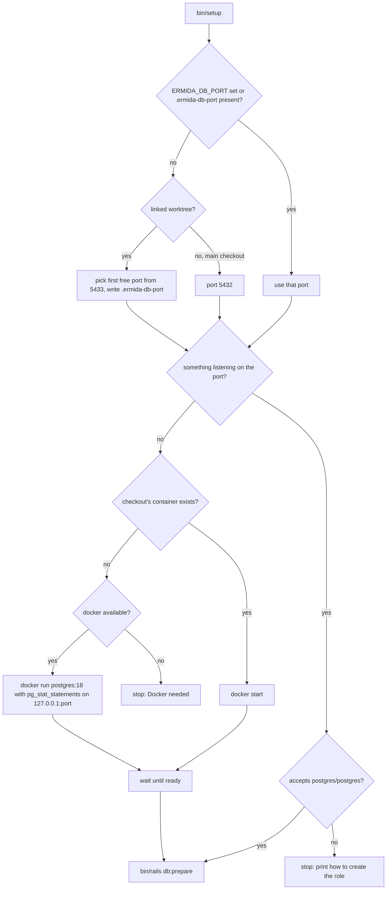

# Develop on the host, as 37signals does with Fizzy - Plan

## Goal Capsule

- **Objective:** A developer or an agent works on ermida directly on macOS or Arch/Omarchy, setting up a checkout, running the server, the tests and `bin/ci`, and committing, the way 37signals works on Fizzy, with Docker used only to run Postgres.
- **Means:** the app, Ruby and the tools move from the dip/`.dockerdev` containers to the host, installed by mise and `bin/setup` (KTD1-KTD4); dip and `.dockerdev` go away.
- **Product authority:** the repository owner's decisions in the brainstorm of 2026-11-06, recorded under Key Decisions. The Product Contract wins on behavior; the KTDs win on mechanism.
- **Execution profile:** one pull request, units U1-U6 in dependency order. Configuration and scripts, so proof is mostly running them (`bin/setup` in a fresh worktree, `bin/ci`, `bin/dev`), plus unit tests for the database port resolution.
- **Stop conditions:** stop and report if a fresh worktree cannot reach a passing `bin/ci` on macOS, if GitHub CI goes red for a reason the change caused, or if keeping CI or the production image build working would require reversing a Key Decision.
- **Who finishes:** the implementing agent ships the PR; the repository owner merges, and verifies the Arch/Omarchy path on a machine that has it.
- **Open blockers:** none.

---

## Product Contract

### Summary

Ruby 4.0.9 and the command-line tools come from mise, and `bin/setup` installs the system libraries with Homebrew on macOS or pacman on Arch/Omarchy, then brings the checkout up. Postgres 18 is the one thing left in Docker: `bin/setup` uses a Postgres already listening, or starts a plain container, and each worktree gets its own on its own port. dip, `.dockerdev/` and the browserless Chrome service are removed, and the commands become `bin/setup`, `bin/dev`, `bin/rails` and `bin/ci`.

### Problem Frame

The app runs in Docker through dip, a setup the project inherited from its template ("Ruby on Whales") without a recorded reason. Over one day of work it caused most of the friction:

- `flock` does not lock on the macOS bind mount, so parallel test workers overwrote each other's coverage. Coverage had to move into the `bundle` volume through `COVERAGE_DIR`.
- Committing needs Docker running, because the RuboCop and archspec hooks call `dip`.
- `bin/ci` runs inside the image, so every tool it uses, gitleaks for one, has to be built into the image.
- Each new worktree needs its own `.dockerdev/.env` and `node_modules`. A worktree that ran without `.env` left files in the shared `bundle` volume owned by the wrong user, and that stopped the bundler-audit advisory database from updating.
- Docker-only workarounds pile up: `RAILS_ENV` left empty on purpose, a browserless container for system tests, web-console permissions for the Docker gateway, and Vite allowing the host `vite`.

Fizzy, 37signals' open-source app, runs on the host and keeps containers for data services only.

### Key Decisions

- **Develop on the host, as Fizzy does.** Docker caused the problems above, and Fizzy shows the host model working for a Rails 8 app. Governs R1, R2, R12. (session-settled: user-directed — chosen over keeping the containers and building gitleaks into the dev image: the container model kept costing workarounds.)
- **Postgres the way Fizzy runs MySQL.** Use a Postgres already listening on the checkout's port, otherwise run a plain container. Governs R4. (session-settled: user-directed — chosen over always a container, and over Postgres installed only through Homebrew: it matches Fizzy and still lets a local Postgres 18 serve.)
- **Remove dip and `.dockerdev/` entirely.** Fizzy has no wrapper, and the commands are `bin/*`. Governs R12, R13. (session-settled: user-directed — chosen over keeping dip as a host-side shortcut, and over keeping Docker as an alternative path: one path to maintain.)
- **macOS and Arch/Omarchy.** These are the two platforms Fizzy's `bin/setup` supports. Governs R2. (session-settled: user-directed — chosen over macOS only, and over macOS plus Debian/Ubuntu.)
- **One Postgres per worktree, on its own port, as Fizzy SaaS does.** A worktree that would otherwise share the main checkout's databases refuses to boot instead. Governs R5, R6, R7. (session-settled: user-directed — chosen over one Postgres with worktree-suffixed database names, and over sharing as today: a `db:test:prepare` in one worktree would reset every other's test database.)
- **System tests use the host's Chrome.** Cuprite already launches a local Chrome when `CHROME_URL` is unset, which is how GitHub CI runs. Governs R2, R9.
- **Development data is not migrated.** `bin/setup` recreates the databases from the schema and seeds, and the old Docker volumes are left to the developer to delete. Governs R4.

### Requirements

**Toolchain and setup**

- R1. Ruby, from `.ruby-version`, and the command-line tools the hooks and `bin/ci` use (prek, gitleaks, actionlint) come from a mise configuration committed to the repo, each at a pinned version.
- R2. On a fresh macOS (Homebrew) or Arch/Omarchy (pacman) machine, `bin/setup` installs what the app needs from the system: libvips, the Postgres 18 client, Chrome or Chromium for system tests, and gitleaks. Then it installs the gems, including the rails-hyperdrive Bundler plugin kept out of the Gemfile, the JavaScript packages, the databases and the git hooks.
- R3. Running `bin/setup` again on a checkout that is already set up finishes cleanly and changes nothing.

**Database**

- R4. Development and test use Postgres 18 with `pg_stat_statements` loaded, which pghero needs. When nothing listens on the checkout's port, `bin/setup` starts that checkout's Postgres container, or creates it with a persistent volume the first time.
- R5. Each git worktree has its own Postgres on its own port, and the main checkout uses 5432.
- R6. In a worktree with no Postgres port configured, the app refuses to boot in development and test. The refusal says how to configure a port, or how to point at the main checkout's Postgres on purpose.
- R7. `bin/setup` in a new worktree picks a free port and records it in an untracked local file, so a worktree an agent creates works without manual steps.

**Daily commands**

- R8. `bin/dev` starts the Rails server, with the Solid Queue worker inside Puma, together with the Vite dev server. `PORT` moves the Rails server, so two checkouts can serve at once.
- R9. `bin/rails test`, `bin/rails test:system`, the console and `bin/ci` run on the host, with no container other than Postgres.
- R10. The git hooks (gitleaks, RuboCop, archspec, actionlint, the commit message check and the pre-push check) run on the host, and committing does not need Docker.
- R11. `bin/ci` scans the tree with gitleaks, as the `gitleaks` job in `.github/workflows/checks.yml` does.

**What goes away**

- R12. `dip.yml`, `.dockerdev/`, the browserless service, and the settings that exist only for the containers are removed. Those settings are `COVERAGE_DIR`, the empty `RAILS_ENV`, the Docker gateway in web-console permissions, and the `vite` host in the Vite config. Coverage goes back to `coverage/`.
- R13. `AGENTS.md`, `README.md` and the solutions under `.compound-engineering/artifacts/solutions/developer-experience/` describe the host workflow. The plans in `.compound-engineering/artifacts/plans/` stay as written, as records of past work.
- R14. The production `Dockerfile`, Kamal and the GitHub workflows behave as they do today.

### Acceptance Examples

- AE1. **Covers R4.** **Given** a Postgres 18 already listening on 5432 on the Mac, **when** `bin/setup` runs in the main checkout, **then** it uses that Postgres and starts no container.
- AE2. **Covers R3, R4.** **Given** a checkout whose Postgres container exists but is stopped, **when** `bin/setup` runs, **then** it starts that container and keeps its data.
- AE3. **Covers R5, R7.** **Given** two worktrees each set up by `bin/setup`, **when** both run `bin/rails test` at the same time, **then** each uses its own test database and neither fails because of the other.
- AE4. **Covers R6.** **Given** a worktree with no Postgres port configured, **when** someone runs `bin/rails test` there, **then** it stops before touching any database and says how to configure the port.

### Success Criteria

- A fresh clone on macOS gets from `bin/setup` to a passing `bin/ci` and a working `bin/dev` without dip and without any container besides Postgres.
- A fresh clone on Arch/Omarchy gets to the same result.
- The day-to-day commands match Fizzy's: `bin/setup`, `bin/dev`, `bin/rails`, `bin/ci`.

### Scope Boundaries

- SQLite and importmap stay out, even though Fizzy uses them. Both would change the app, not the environment.
- Moving existing development data out of the Docker volumes.
- Linux distributions other than Arch/Omarchy.
- Automatic per-worktree ports for the Rails server, Vite (3036) and the metrics endpoint (9394). `PORT` covers running two servers at once.
- Production (`Dockerfile`, Kamal) and the GitHub workflows, per R14.

### Sources / Research

- Fizzy (basecamp/fizzy): `.mise.toml` (`[tools]` and `[bootstrap.packages]`, including `pacman:gitleaks`), `bin/setup` (`oss_mysql_setup`: checks `localhost:3306`, then `docker start` or `docker run --name fizzy-mysql mysql:8.4`), `saas/config/database.yml` (`FIZZY_DB_PORT` required in a git worktree), `Procfile.dev`.
- Current setup: `dip.yml`, `.dockerdev/compose.yml` (Postgres with `pg_stat_statements`, browserless `chrome`, `COVERAGE_DIR`, `WEB_CONSOLE_PERMISSIONS`, `vite` service), `config/database.yml` (header on `DATABASE_URL` and `PG*` variables), `prek.toml` (hooks through `dip`), `test/application_system_test_case.rb` (`CHROME_URL`), `.simplecov`, `vite.config.ts`, `config/vite.json`, `config/puma.rb`, `bin/setup`, `bin/dev`.
- The problems in the Problem Frame were hit and fixed in PRs #25 and #29.
- Fizzy's macOS packages come from a `Brewfile` installed with `brew bundle`, its Arch packages from `mise bootstrap packages`, and its `bin/dev` runs foreman over `Procfile.dev`.
- Learnings: `.compound-engineering/artifacts/solutions/developer-experience/fresh-worktree-test-run-oom-killed-by-vite-build.md` (a worktree without `node_modules` loops in `bin/bun-vite`; keep the guard and the install) and `.compound-engineering/artifacts/solutions/developer-experience/migrate-rewrites-solid-schema-dumps.md` (migrations rewrite the Solid schema dumps; roll back with `db:rollback:primary`).

---

## Planning Contract

**Product Contract preservation:** restructured, no scope change. The Outstanding Questions are answered by KTD3-KTD6 and KTD10 and were removed; R1-R14, AE1-AE4 and the Key Decisions are unchanged.

### Key Technical Decisions

- KTD1. **A committed `.mise.toml` pins Ruby and the tools, as Fizzy's does.** Ruby comes from `.ruby-version` through mise's idiomatic version file setting, so CI (`ruby/setup-ruby`), the production `Dockerfile` and mise share one source. prek, gitleaks and actionlint are pinned in `[tools]` at the versions `.github/workflows/checks.yml` runs (gitleaks 8.30.1, actionlint 1.7.12), and the hooks call them through `mise exec --` without an inline version. Governs R1, R10.
- KTD2. **System packages come from a `Brewfile` on macOS and from `[bootstrap.packages]` in `.mise.toml` on Arch/Omarchy, as in Fizzy.** `bin/setup` installs mise itself when missing (Homebrew or pacman), trusts the repo config, then checks before installing (`brew bundle check`, `mise bootstrap packages status`), so a set-up machine skips straight past. The list covers libvips, libyaml, the Postgres 18 client and the C toolchain. gitleaks is not in it: it comes from mise (KTD1), so there is one pinned copy. On macOS, Chrome is installed with `brew install --cask google-chrome` only when neither Chrome nor Chromium is in `/Applications`, where Ferrum looks. On Arch it is `chromium`, which Ferrum finds on `PATH`. Governs R2, R3.
- KTD3. **Development and test connect over TCP to `127.0.0.1` as `postgres`/`postgres`, on a port resolved per checkout.** A local-connection anchor carries host, port and credentials and is merged into every development entry and into test. Production is untouched, and `DATABASE_URL` still overrides the primary database, which keeps GitHub CI as it is. The port is `ERMIDA_DB_PORT` when set, otherwise the untracked `.ermida-db-port` file, otherwise 5432. In a linked worktree, where `.git` is a file, with no `DATABASE_URL` and no port from either source, loading the config raises, and the message says how to set the port or point at the main checkout's Postgres on purpose. That condition is false in GitHub CI (`.git` is a directory), in the CI coverage job, and in the production image build (no `.git`), all of which evaluate `config/database.yml` when rake tasks load. The resolution is plain Ruby in `config/local_database.rb`, loaded from the YAML's ERB. It is not an `ApplicationConfig`: anyway_config reads local files only in development, so the port would not reach test runs, and the repo's anyway-config skill keeps settings Rails and the adapter read directly, such as `DATABASE_URL`, out of config classes (pack: layered-rails, configuration-goes-through-anyway-config.md). Governs R4, R5, R6. (session-settled: user-directed, chosen over one Postgres with worktree-suffixed database names: per the Key Decision on one Postgres per worktree.)
- KTD4. **`bin/setup` provisions Postgres the way Fizzy's `oss_mysql_setup` does.**
  1. Resolve the port (KTD3).
  2. In a worktree with no recorded port, pick the first free port from 5433 up, skipping ports that other `ermida-postgres-*` containers publish. Write it to `.ermida-db-port` before any `bin/rails` call.
  3. If something listens on the port, use it after confirming it accepts `postgres`/`postgres`. If it does not, stop with the commands that create that role. If its `shared_preload_libraries` lacks `pg_stat_statements` (R4), warn and say how to add it; pghero's query stats stay empty until then.
  4. Otherwise `docker start` the checkout's container when it exists. When it does not, `docker run` it: `ermida-postgres` for the main checkout, `ermida-postgres-<worktree directory name>` for a worktree. It uses image `postgres:18`, a named volume with the container's name, `-c shared_preload_libraries=pg_stat_statements`, `POSTGRES_PASSWORD=postgres`, and publishes only on `127.0.0.1:<port>`.
  5. Wait until it accepts connections.

  When Docker is needed and missing, stop and say so. Governs R4, R5, R7. (session-settled: user-directed, chosen over always a container and over Homebrew only: per the Key Decision on Postgres.)
- KTD5. **`bin/dev` runs foreman over a `Procfile.dev` with a `web` process and a `vite` process, as Fizzy's does and as vite_ruby suggests.** `bin/dev` installs foreman with `gem install` when missing, as Fizzy's does. It exports `PORT` before starting foreman, defaulting to 3000 and keeping a caller-set value, because foreman otherwise hands the first process `PORT=5000`. The `web` line passes `PORT` to Puma, and the `vite` process takes its port from `config/vite.json`, not from foreman. The `web` line sets `SOLID_QUEUE_IN_PUMA`, which compose used to set. It also binds the yabeda exporter to `127.0.0.1:9394` through `PROMETHEUS_EXPORTER_BIND` and `PROMETHEUS_EXPORTER_PORT`. On the host the exporter would otherwise listen on every interface, and with `PORT` set it would try to take Puma's port. Debugging with a TTY uses `bin/rails server` directly, which the docs say. Governs R8.
- KTD6. **`bin/setup` stays a Ruby script in Rails' stock shape, using only the standard library before `bundle install`.** It keeps `--skip-server` and `--reset`. Every new step is idempotent and fast when already satisfied, because `bin/ci`'s Setup step runs it on every CI run. Order: mise, system packages, `mise install`, gems (including the bundler-hyperdrive plugin, version 0.2.0, kept out of the Gemfile), `bin/bun install`, Postgres (KTD4), `bin/rails db:prepare`, git hooks (`prek install`), log and tmp cleanup, then `bin/dev` unless `--skip-server`. Governs R2, R3, R7.
- KTD7. **`Gemfile.lock` gains `arm64-darwin` and `x86_64-darwin`.** Without them, the first `bundle install` on a Mac rewrites the lockfile in every checkout. Every native gem at its locked version has darwin builds. Governs R2.
- KTD8. **`bin/ci` scans the working tree with `gitleaks dir`, with a committed `.gitleaks.toml` that skips the ignored output directories.** Those directories are `node_modules`, `log`, `tmp`, `coverage`, `storage` and the Vite build outputs. A fresh CI checkout does not have them, so the local scan sees what CI's `gitleaks` job sees. Governs R11.
- KTD9. **System tests use the host's Chrome, and coverage goes back to `coverage/`.** The `CHROME_URL` branch in the system test case and the Chrome host allowance in the test helper's WebMock and VCR setup go away. `COVERAGE_DIR` goes away too, because `flock` works on the native disk. Governs R9, R12.
- KTD10. **The `.dockerdev` conveniences are dropped, not replaced.** That means the console history volume, `.irbrc` and `MALLOC_ARENA_MAX`. On the host the developer's own IRB and shell settings apply. Governs R12.

### High-Level Technical Design

How `bin/setup` gets a checkout to a working database (KTD3, KTD4):

How `config/database.yml` resolves the port when Rails or rake loads it (KTD3):

| Context | `DATABASE_URL` | `.git` | Env or file | Result |
|---|---|---|---|---|
| Main checkout | unset | directory | none | 5432 |
| Worktree after `bin/setup` | unset | file | `.ermida-db-port` | that port |
| Worktree never set up | unset | file | none | raises with instructions |
| GitHub CI test jobs | set | directory | none | `DATABASE_URL` wins (primary); 5432 otherwise |
| CI coverage job, image build | unset | directory or absent | none | 5432, never raises |

### Assumptions

- A Postgres already running on the Mac that `bin/setup` reuses has a `postgres` role with password `postgres`, or the developer creates it from the printed commands.
- The old Docker volumes (`ermida_dev_*`) and their development data are left for the developer to delete; nothing migrates them.
- Worktree directory names are unique among this repo's worktrees. herdr names them that way.
- Existing worktrees' `node_modules` carry Linux-only native packages from the container. `bin/bun install` on the host adds the darwin ones, and deleting `node_modules` is the fallback the docs give.
- The Arch/Omarchy path cannot be run on this machine. It is built from Fizzy's and verified by the repository owner.

### System-Wide Impact

- **Other worktrees and the agents working in them:** after the merge, a worktree that pulls `main` loses `dip` and must run `bin/setup` once. The worktree check (R6) makes the first `bin/rails` call there say so instead of failing on a missing database. The PR body says it.
- **The main checkout:** keeps port 5432, so its Postgres is either an existing local one or `ermida-postgres`, not the compose project's random port.
- **GitHub CI and production:** keep working because `DATABASE_URL` overrides the local connection, and the worktree check is inert without a `.git` file (KTD3 table).
- **`.mcp.json` (rails-hyperdrive):** points at `localhost:3000`, which `bin/dev` serves. No change.

### Risks

- **A Solid schema dump rewritten by `db:prepare` would leave a new worktree with a dirty git tree.** Verification checks `git status` after `bin/setup` in a fresh worktree. If it is dirty, regenerate and commit the dumps once (the schema-dumps learning).
- **Hooks run from a GUI git client may lack mise's shell activation.** Calling every tool through `mise exec --` (KTD1) resolves the pinned versions anyway.
- **The Homebrew cask fails when a Chrome app exists that Homebrew did not install.** KTD2 runs it only when no Chrome or Chromium app exists.
- **Two worktrees set up at the same moment can pick the same free port.** Considered and not built: the second `docker run` fails loudly on the busy port, and rerunning `bin/setup` picks the next one. A lock would be worth it only if agents start creating worktrees in parallel as a matter of course.

---

## Implementation Units

### U1. Pin the toolchain and the system packages

- **Goal:** a committed mise config and `Brewfile` describe everything the host needs, and the lockfile works on a Mac.
- **Requirements:** R1, R2; KTD1, KTD2, KTD7.
- **Dependencies:** none.
- **Files:** `.mise.toml` (new), `Brewfile` (new), `Gemfile.lock`, `.gitignore` (add `/.ermida-db-port`), `.github/workflows/checks.yml` (a comment pointing at `.mise.toml` next to the gitleaks and actionlint `VERSION`s).
- **Approach:**
  1. `.mise.toml`: Ruby from `.ruby-version`; `[tools]` prek 0.5.7, gitleaks 8.30.1, actionlint 1.7.12; `[bootstrap.packages]` with the pacman names.
  2. `Brewfile`: vips, libyaml and the Postgres 18 client. Docker stays out of it: it remains the developer's own install, which `bin/setup` checks only when it needs a container (KTD4).
  3. Add the darwin platforms to `Gemfile.lock`.
- **Patterns to follow:** Fizzy's `.mise.toml` and `Brewfile`.
- **Test expectation:** none -- configuration only; U3's run of `bin/setup` exercises it.
- **Verification:** `mise install` in the checkout gives Ruby 4.0.9 and the three pinned tools; `bundle install` on the Mac leaves `Gemfile.lock` unchanged.

### U2. Resolve the database connection per checkout

- **Goal:** development and test connect to the checkout's own Postgres, and an unconfigured worktree refuses to boot.
- **Requirements:** R4, R5, R6; AE4; KTD3.
- **Dependencies:** none.
- **Files:** `config/local_database.rb` (new), `config/database.yml`, `test/config/local_database_test.rb` (new).
- **Approach:**
  1. `config/local_database.rb`: the port resolution and the worktree check from KTD3, as plain Ruby with no Rails dependency, taking the app root and the environment as inputs so tests can drive it.
  2. `config/database.yml`: the local-connection anchor merged into the four development entries and into test, and the header comment rewritten for the host. Production stays as it is.
- **Execution note:** write the resolver test-first; it is the one piece of new logic with branches.
- **Patterns to follow:** `test/configs/authentication_config_test.rb` for the shape of a small config test.
- **Test scenarios:**
  - Main checkout (`.git` is a directory), no env, no file: port 5432.
  - `ERMIDA_DB_PORT=5544` set: port 5544, even with a different port in `.ermida-db-port`.
  - Worktree (`.git` is a file) with `.ermida-db-port` containing `5433`: port 5433.
  - Covers AE4. Worktree with no env, no file and no `DATABASE_URL`: raises, and the message names `bin/setup` and `ERMIDA_DB_PORT`.
  - Worktree with `DATABASE_URL` set and no port: does not raise.
  - No `.git` at all (production image build): port 5432, never raises.
  - `.ermida-db-port` with surrounding whitespace or a trailing newline: reads the number.
- The seam is the resolver called directly, which catches every branch of the resolution. It misses the YAML wiring, which U3's `bin/rails` calls in a fresh worktree cover.
- **Verification:** the new test passes; `bin/rails runner` in a worktree without a port stops with the message.

### U3. Rewrite `bin/setup` for the host

- **Goal:** one command takes a fresh macOS or Arch checkout, main or worktree, to a working app, and a second run changes nothing.
- **Requirements:** R2, R3, R4, R5, R7; AE1, AE2, AE3; KTD2, KTD4, KTD6.
- **Dependencies:** U1, U2.
- **Files:** `bin/setup`.
- **Approach:** the step order in KTD6, with the Postgres steps in KTD4 and the flowchart above. `bin/setup` writes `.ermida-db-port` before its first `bin/rails` call, because the worktree check would otherwise stop `db:prepare`.
- **Execution note:** mostly scripting; prove it by running it, not by unit tests.
- **Patterns to follow:** the current `bin/setup` (`system!`, `APP_ROOT`, `--skip-server`, `--reset`) and Fizzy's `bin/setup` steps.
- **Test scenarios** (run by hand):
  - Covers AE1. A Postgres 18 already listening on 5432 with the `postgres` role: the main checkout uses it and starts no container.
  - Covers AE2. The checkout's container exists but is stopped: `bin/setup` starts it, and the data survives.
  - Covers AE3. Two fresh worktrees: each gets its own port and container, and both run `bin/rails test` at the same time without failures.
  - Something listens on the port without the `postgres` role: `bin/setup` stops and prints how to create it.
  - A second `bin/setup` on a set-up checkout installs nothing and leaves `git status` clean.
- **Verification:** the scenarios above on this Mac; `bin/ci` passes in a fresh worktree after `bin/setup`.

### U4. Run the server on the host

- **Goal:** `bin/dev` serves the app with Vite, the job worker and the metrics endpoint, without containers.
- **Requirements:** R8, R12; KTD5.
- **Dependencies:** U3.
- **Files:** `bin/dev`, `Procfile.dev` (new), `vite.config.ts` (drop `allowedHosts: ['vite']`), `config/environments/development.rb` (drop the `WEB_CONSOLE_PERMISSIONS` read and its comment; update the comment that says `dip rails s`).
- **Approach:** KTD5. `PORT` moves the `web` process; the exporter keeps its own address.
- **Patterns to follow:** Fizzy's `bin/dev` and `Procfile.dev`.
- **Test expectation:** none -- process wiring; verified by running it.
- **Verification:**
  - `bin/dev` serves `http://localhost:3000` with Vite's hot reload, despite foreman's own default port.
  - `/jobs` shows the Solid Queue worker running.
  - `/up` answers.
  - `curl 127.0.0.1:9394/metrics` answers.
  - `PORT=3100 bin/dev` serves on 3100.

### U5. Run tests, hooks and `bin/ci` on the host

- **Goal:** the suite, the system tests, the hooks and `bin/ci` run on the host, with gitleaks in `bin/ci`.
- **Requirements:** R9, R10, R11, R12; KTD1, KTD8, KTD9.
- **Dependencies:** U3.
- **Files:**
  - `test/application_system_test_case.rb`
  - `test/test_helper.rb`
  - `test/test_helpers/system_session_test_helper.rb` (stale comment)
  - `.simplecov`
  - `lib/tasks/coverage.rake` (comment)
  - `config/ci.rb` (coverage reset on `coverage/`, a gitleaks step, the Chrome comment)
  - `prek.toml` (RuboCop and archspec through `mise exec -- bin/rubocop` and `mise exec -- bundle exec archspec`; gitleaks and actionlint through `mise exec --`; comments pointing at `bin/setup` and `checks.yml`)
  - `.gitleaks.toml` (new)
  - `bin/bun-vite` (its message names `bin/bun install`, not `dip bun install`)
- **Approach:** KTD9 for the tests and coverage, KTD8 for gitleaks, KTD1 for the hooks.
- **Test expectation:** none -- test harness and tooling configuration; the suite itself is the proof.
- **Verification:**
  - `bin/rails test` and `bin/rails test:system` pass on the host, with the system tests opening the local Chrome.
  - `bin/ci` passes, including the gitleaks step and the coverage floor.
  - `prek run --all-files` passes, and a commit works with Docker stopped.

### U6. Remove the Docker development setup and rewrite the docs

- **Goal:** nothing dip or `.dockerdev` remains, and the docs teach the host workflow.
- **Requirements:** R12, R13, R14.
- **Dependencies:** U3, U4, U5.
- **Files:**
  - delete `dip.yml` and `.dockerdev/`
  - `.dockerignore` (drop the dead `/.dockerdev/` and `/dip.yml` lines)
  - `AGENTS.md`
  - `README.md`
  - `.compound-engineering/artifacts/solutions/developer-experience/fresh-worktree-test-run-oom-killed-by-vite-build.md`
  - `.compound-engineering/artifacts/solutions/developer-experience/migrate-rewrites-solid-schema-dumps.md`
- **Approach:**
  - **`AGENTS.md`:** the command list moves to `bin/setup`, `bin/dev`, `bin/rails`, `bin/ci` and `bin/rails dbconsole`. It also covers the per-worktree Postgres and port, the host Chrome, and the coverage location, and drops the Docker-only notes.
  - **`README.md`:** names the requirements: mise, Homebrew or pacman, and Docker for Postgres.
  - **Unchanged:** the older plans in `.compound-engineering/artifacts/plans/`, the production `Dockerfile` and `config/deploy.yml`.
- **Test expectation:** none -- removal and documentation.
- **Verification:** `rg -n 'dip |dip\.yml|\.dockerdev|COVERAGE_DIR|CHROME_URL'` finds nothing outside the historical plans; GitHub CI is green.

---

## Verification Contract

| Check | Proves | When |
|---|---|---|
| `bin/rails test test/config/local_database_test.rb` | port resolution and the worktree guard (R5, R6) | U2 |
| `bin/setup` in a fresh worktree, then again | setup, per-worktree Postgres, idempotence (R2-R5, R7) | U3 |
| `bin/ci` in that worktree | tests, system tests, boot, gitleaks, coverage floor on the host (R9, R11) | U5, final |
| `mise exec prek -- prek run --all-files`, plus a commit with Docker stopped | hooks on the host (R10) | U5 |
| `bin/dev`, then `/up`, `/jobs` and `127.0.0.1:9394/metrics` | server, worker, Vite, exporter (R8) | U4 |
| GitHub CI on the PR (`checks.yml`, `ci.yml`, security) | CI unchanged (R14) | final |

## Definition of Done

- Every unit's verification above holds on this Mac.
- GitHub CI is green on the PR.
- `rg` finds no `dip`, `.dockerdev`, `COVERAGE_DIR` or `CHROME_URL` outside the historical plans.
- `git status` is clean after `bin/setup` and after `bin/ci` in a fresh worktree.
- No leftover code from abandoned attempts is in the diff.
- The PR body states that the Arch/Omarchy path is untested here and names the old Docker volumes the developer can delete.
